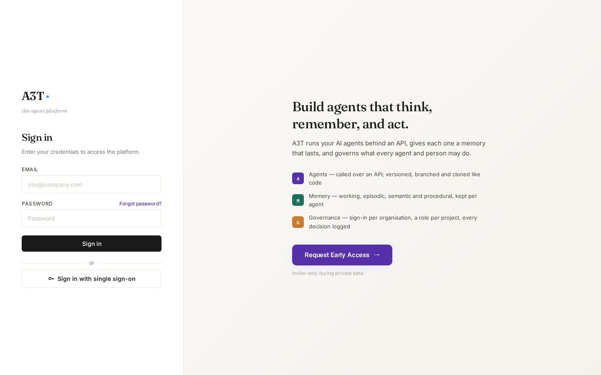
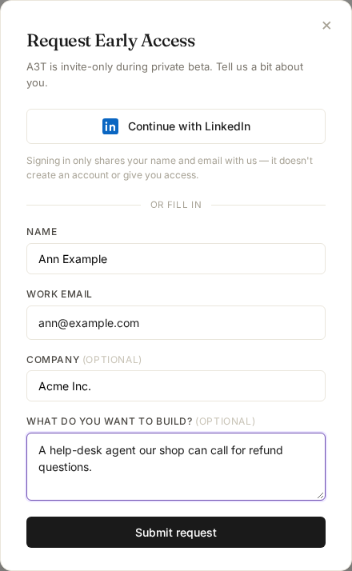
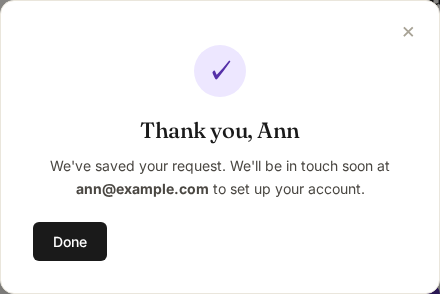
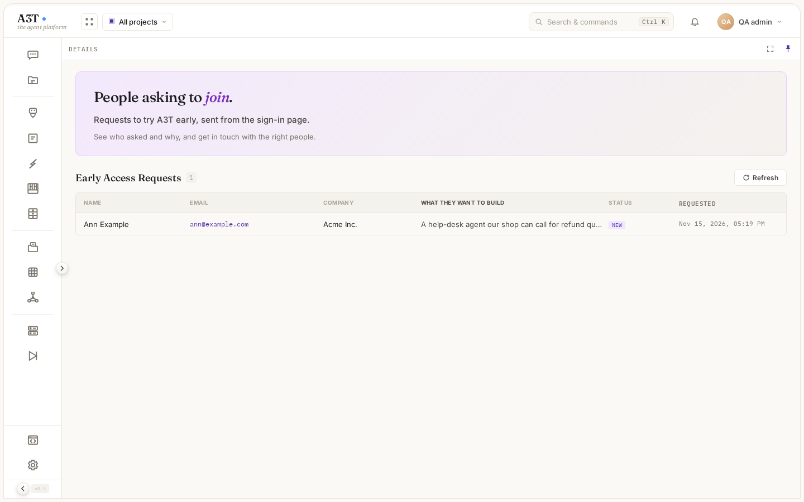
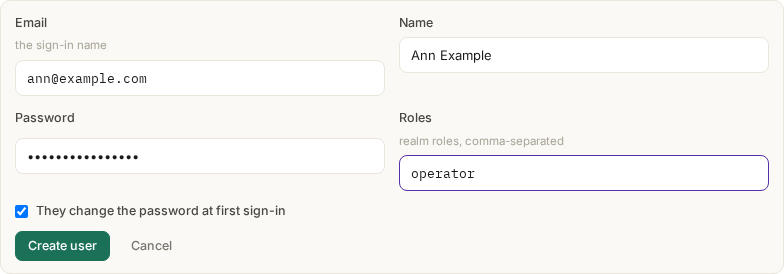
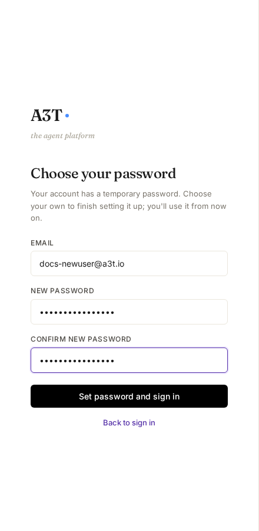
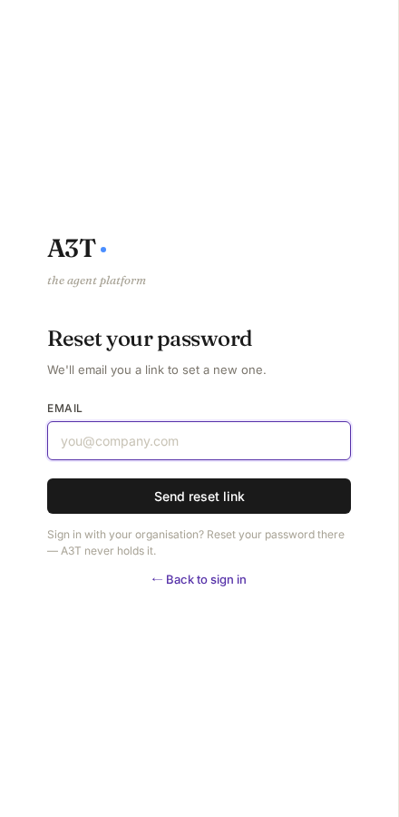
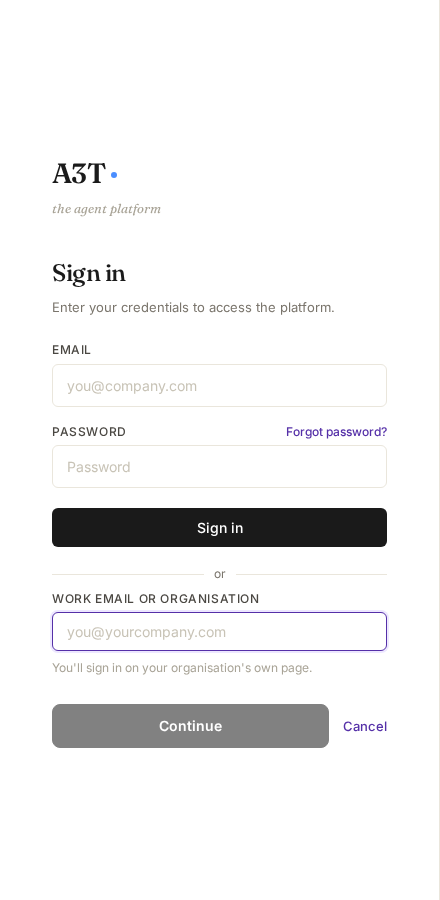
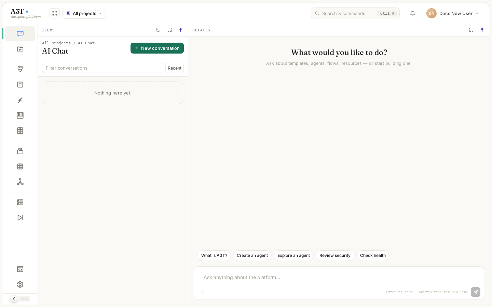

import { Aside, Steps } from '@astrojs/starlight/components';

The A3T console is at **[dash.a3t.io](https://dash.a3t.io)**. It is where you build agents and flows, connect resources, set policies and watch runs. During the private beta, accounts are by invitation: you **request early access**, an A3T admin makes your account, and you **sign in**.

<Steps>

1. [Request early access](#1-request-early-access) on the sign-in page.
2. [Get your account](#2-get-your-account): an admin reads your request and makes it.
3. [Sign in](#3-sign-in) with your email and password, or with your organisation's single sign-on.
4. [Find your way around](#4-after-you-sign-in), then follow the [Quick start](../../getting-started/quickstart/).

</Steps>

<Aside type="tip">
Does your organisation already use A3T with its own sign-in (single sign-on)? Then you don't need to request access: go to [step 3](#3-sign-in) and choose **Sign in with single sign-on**.
</Aside>

## 1. Request early access

Open [dash.a3t.io](https://dash.a3t.io). You land on the sign-in page; on the right is **Request Early Access**. On a phone the button is under the sign-in form.

**Request Early Access** opens a short form. Fill it in by hand, or choose **Continue with LinkedIn** to fill in your name and email from your LinkedIn profile.

| Field | What it is for | What to put | Example |
|---|---|---|---|
| **Continue with LinkedIn** | Fills in your name and a verified email from LinkedIn. It only shares those two; it does **not** create an account or sign you in | Use it, or fill in the fields below instead | — |
| **Name** *(required)* | How we address you | Your full name | `Ann Example` |
| **Work email** *(required)* | Where we reach you, and the email you will sign in with | The address you want your account under | `ann@example.com` |
| **Company** *(optional)* | Who you build for | Your company or team | `Acme Inc.` |
| **What do you want to build?** *(optional)* | Helps us set up the right access | A sentence about your use | `A help-desk agent our shop can call for refund questions.` |

**Submit request** saves it and thanks you. Nothing else happens yet: no account exists and no email is sent. We reply at the email you gave.

## 2. Get your account

This step is done by an **A3T admin**, not by you. It is here so you know what to expect, and so admins know what to do.

**Reading requests.** An **Admin** or **SuperAdmin** opens [dash.a3t.io/early-access](https://dash.a3t.io/early-access): every request, newest first, with name, email, company, what they want to build, status and when they asked.

**Making the account.** A **SuperAdmin** or **SecurityAdmin** opens [Security](https://dash.a3t.io/security) › **Identity** › **Users** › **Manage** › **+ User**:

| Field | What it means | What to put | Example |
|---|---|---|---|
| **Email** | The sign-in name. Can't be changed later | The email from the request | `ann@example.com` |
| **Name** | Shown in the top bar, in members lists and in logs | Their full name | `Ann Example` |
| **Password** | Their first password. With the box below ticked it is temporary: it works once, to choose their own | At least 8 characters. Send it separately from the email | — |
| **Roles** | What they may do, everywhere in A3T. Comma-separated; the highest one counts | `operator` for someone who builds; `viewer` to read only | `operator` |
| **They change the password at first sign-in** | The first password is temporary: at their first sign-in, the console asks them to choose their own before going in | Leave it ticked, so only they know their password | on |

| Role | What they may do |
|---|---|
| `viewer` | Read everything they can see; create nothing |
| `operator` | Build in their own projects and the projects they are members of. **Most people start here** |
| `admin` | Run projects, and read early-access requests; no Security or Decision log |
| `securityadmin` | Security and the Decision log: policies, identity, every decision |
| `superadmin` | Everything, in every organisation |

**Create user** makes the account. Tell the person their email and first password, and send them to [dash.a3t.io](https://dash.a3t.io).

## 3. Sign in

Open [dash.a3t.io](https://dash.a3t.io) and sign in one of three ways.

**Email and password.** Type the **Email** your account was made with and your **Password**, then **Sign in**.

**With an authenticator code.** SuperAdmin and SecurityAdmin accounts always sign in with a password **and** the 6-digit code from an authenticator app; a password alone is refused for them. Choose **I use an authenticator code** under the password field (it opens by itself if the code is missing), type the code, then **Sign in**. **Set up an authenticator** opens your account page in the sign-in realm, where you add the app.

**The first time**, if your admin gave you a temporary password, the console asks you to **Choose your password**: type a **New password** (at least 8 characters, not the temporary one) and **Confirm new password**, then **Set password and sign in**. From then on, sign in with your new password; the temporary one no longer works.

**Forgot password?** Above the password field. Enter your email and we send you a link to set a new password; it works for 30 minutes. The answer is the same whether or not the email has an account, and it is not sent to people who sign in with single sign-on: their password is set by their organisation.

**Sign in with single sign-on.** For organisations that sign their people in with their own provider (connected by its admins under [Security](../security/) › *org* › Identity › Sign-in). Type your **work email** (e.g. `you@yourcompany.com`) or the **organisation's name**, then **Continue**: you sign in on your organisation's own page and come back signed in. If no organisation uses single sign-on for that email or name, the form says so.

## 4. After you sign in

You land in **AI Chat**, the console's assistant. Everything else is in the menu on the left and the bar at the top.

| Where | What it is |
|---|---|
| **Menu** (left) | The apps, in groups: **Home** (AI Chat, Projects), **Agents** (Agents, Templates, Triggers, Canvas, Resources), **Knowledge & data** (Files, Memory, Knowledge), **Security & audit**, **Runtimes & runs**, and **Studio** and **Settings** at the bottom. What you see depends on your role |
| **Project picker** (top bar, *All projects*) | Shows only one project's work in every app. *All projects* shows everything you may see |
| **Search & commands** (`Ctrl K`) | Jump to any app, project or item by name |
| **Your name** (top right) | Your profile, and **Sign out** |
| **Items** and **Details** | Each app lists its items in the middle; the one you open shows on the right |

**Next:** the [Quick start](../../getting-started/quickstart/) makes your first project and agent, step by step.
