import { Aside } from '@astrojs/starlight/components';

**Open it:** [Agents](https://dash.a3t.io/agents) · first item under **Agents** in the console menu.

An **agent** is a template plus its own settings: its instructions, model, tools, memory and keys. Apps call it over HTTP; it remembers what it learns; every step it takes is checked against policy. The [Quick start](../../getting-started/quickstart/) makes one field by field. This page covers everything you can do with it afterwards.

Items lists agents grouped by owner and project. Open one, and its page has seven tabs, in the order you usually need them.

| Tab | What it is for |
|---|---|
| **Overview** | Its endpoints, a test box, the code to call it, its status |
| **Build** | How it works: code, model and tools, hooks, memory, lineage |
| **Access** | Who can call it and what it may do: keys, sharing, controls, endpoints |
| **Audit** | What it did and what changed |
| **Metrics** | Its turns, failures, time and tool calls |
| **Versions & deploy** | Its versions and memory branches, and where it runs |
| **Settings** | Name, description, environment, owner, delete |

## Overview

Everything an app needs, on one card: the **data plane** address (`POST /chat`), its **token** (make a key here), and the **control plane** for your backend. Below it, **Test it** sends messages as you, and **Call it from your app** has the same call in curl, TypeScript and Python. See the [Quick start](../../getting-started/quickstart/#4-make-a-key) for each field.

## Build

### Code

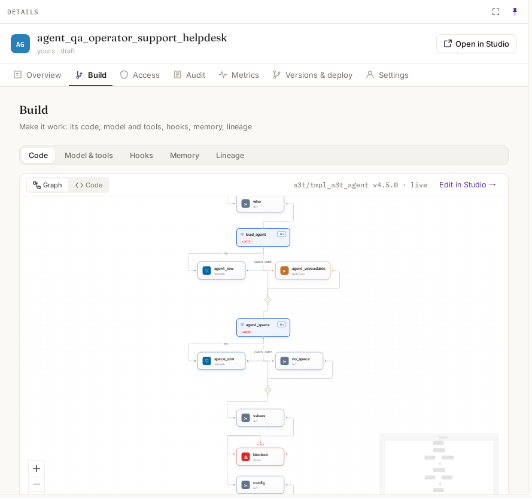

The template it runs, with its version, as a graph of steps and as YAML. **Edit in Studio** opens the template; changing a template changes every agent built from it, so most agents leave this alone. See [Templates](../templates/).

### Model & tools

| Field | What it means | Default |
|---|---|---|
| **Instructions** | What it is told at the start of every conversation | The template's |
| **Model** | The model resource it thinks with | Chosen when it was made |
| **Temperature** | 0: the same answer each time. 1: more varied | `0.7` |
| **Steps per message** | Model and tool calls it may make before it must answer | `10` |
| **Tools** | The MCP tool servers it may call, and which of their tools | None |
| **Memory** | **Across conversations**: what it learns stays. **One conversation**: it remembers only the conversation it is in. **Nothing**: every message on its own | As chosen when it was made |

**Save** applies the change to the next message. Every save that changes something is also a new **version**, noted with what changed.

### Hooks

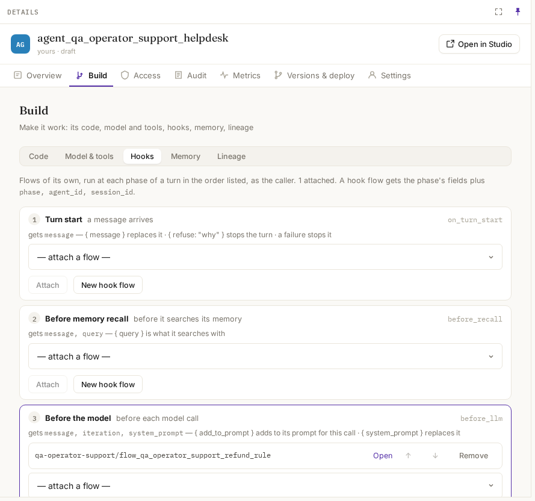

A hook is a flow of yours that runs at a fixed point in every turn, in the order you list them, as the caller. Use one to redact what goes in, guard what comes out, or log to your own system. The phases and the fields each hook receives are listed on the tab; writing hook flows is covered in [Studio](../studio/).

### Memory

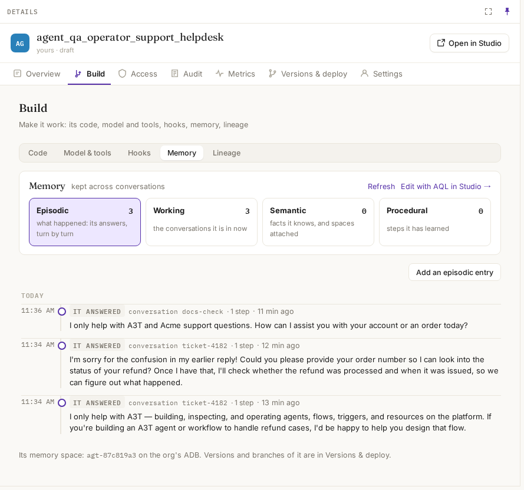

What it remembers, kind by kind, with counts. You can add, change and forget entries here; a forgotten entry leaves every read at once, and the forget is kept in its history. **Edit with AQL in Studio** opens its memory as AQL. To browse across agents, use [Memory](https://dash.a3t.io/memory).

| Kind | What it holds |
|---|---|
| **Working** | What it holds for the task at hand |
| **Episodic** | What happened: its turns, one by one |
| **Semantic** | Facts it knows |
| **Procedural** | How it does things |
| **Tools** | The tools it knows about |

Shared knowledge can be **attached**: a semantic space it recalls from on every turn, without owning it.

### Lineage

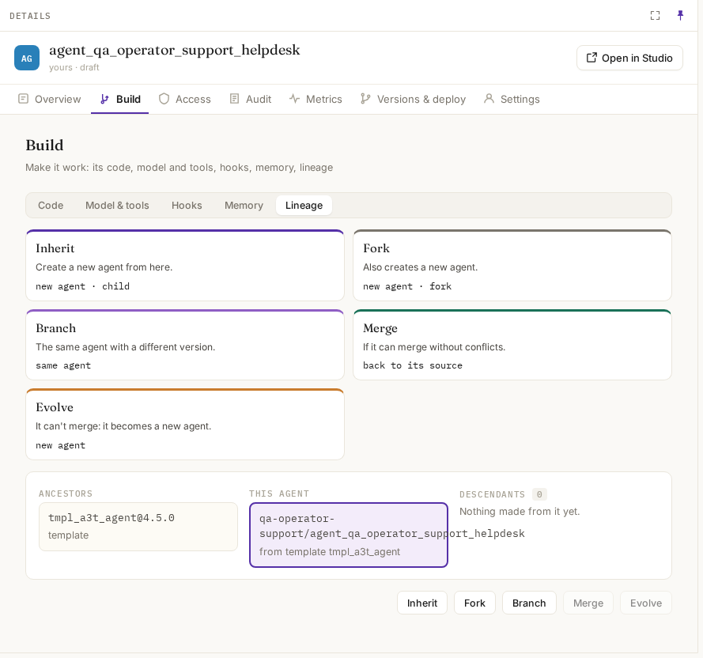

Where it came from and what was made from it, and the ways to make more:

| Action | What you get | Its memory |
|---|---|---|
| **Inherit** | A new agent, a child of this one | Starts its own |
| **Fork** | A new, independent copy | A copy of this one's, then its own |
| **Branch** | The same agent, with a branch to try changes on | A branch of its memory; the agent itself is untouched until you merge |
| **Merge** | A branch brought back into the agent, if nothing conflicts | Facts and procedures learned on the branch are added |
| **Evolve** | A branch that can't merge becomes a new agent | The branch's memory |

Branches are tried and merged on **Versions & deploy**.

## Access

### Keys

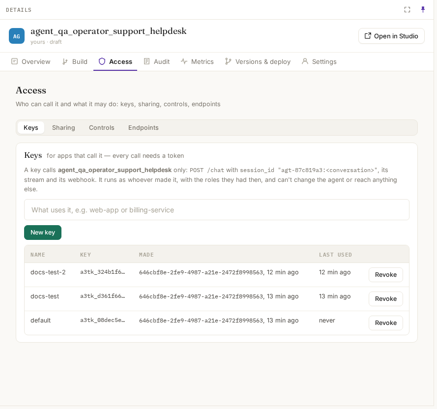

An app needs a key to call the agent. A key (`a3tk_…`) reaches **this agent only**, through `POST /chat` with a `session_id` that starts with this agent's id. It acts with the roles of the person who made it, never more. Each key shows when it was last used. **Revoke** stops it on the next call. Deleting the agent revokes all its keys.

### Sharing

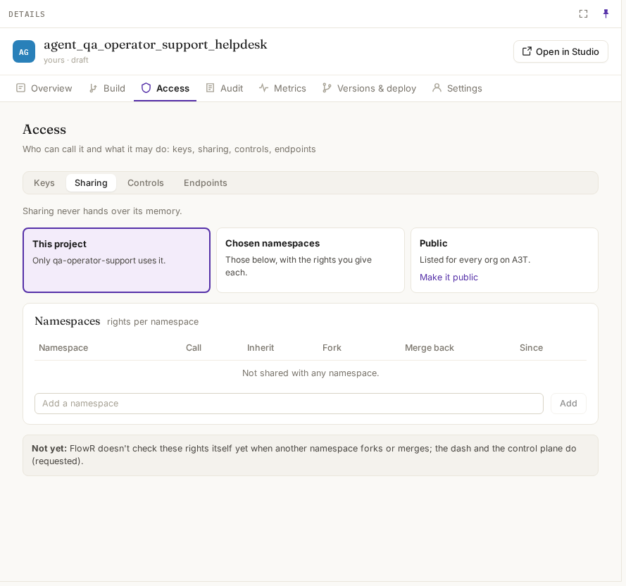

| Choice | Who can use it |
|---|---|
| **This project** (default) | Only its own project |
| **Chosen namespaces** | The projects you add, each with its own rights: **Call**, **Inherit**, **Fork**, **Merge back** |
| **Public** | Listed for every organisation on A3T |

Sharing never hands over its memory.

<Aside type="caution">
The rights per namespace are checked by the console and the control plane. The server does not yet check them itself when another project forks or merges, so treat them as guidance, not a guarantee.
</Aside>

### Controls

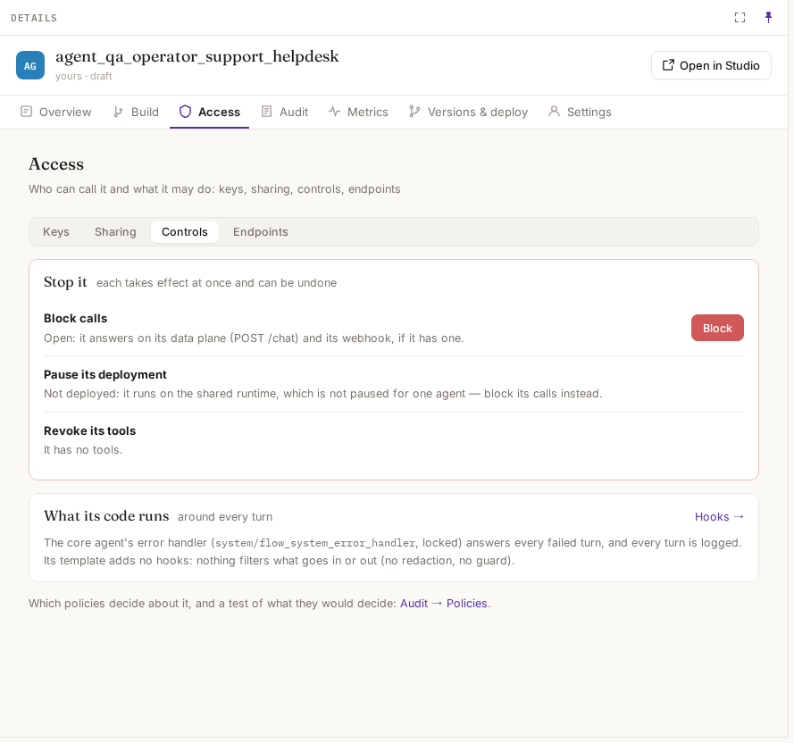

Ways to stop it, each at once and each reversible:

| Control | What it does |
|---|---|
| **Block calls** | Every call to it (`POST /chat`, its webhook) is refused. Its record and memory stay |
| **Pause its deployment** | A deployed agent stops taking work; callers get the paused response. An agent on the shared runtime can't be paused alone: block it instead |
| **Revoke its tools** | Takes away its tools without changing anything else |

The tab also says what runs around every turn: its hooks, and the core agent's error handler, which answers every failed turn.

### Endpoints

Its addresses: the data plane (`POST /chat`, session `<agent id>:<session>`), its webhook (`POST /webhook/agent/<agent id>/chat`) and the control plane, each with whether it is open or blocked.

## Audit

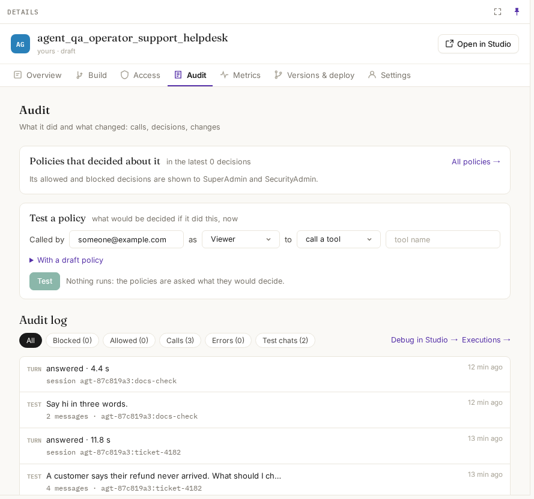

- **Policies that decided about it** and **Test a policy**: what a policy would decide if a given role called it to use a tool, its model or a flow. Decisions themselves are shown to SuperAdmin and SecurityAdmin.
- **Audit log**: its calls, test chats and, for InfoSec, each allowed or blocked decision.
- **Changes**: who changed what and when: settings saved, memory edited or forgotten, shared, blocked.

## Metrics

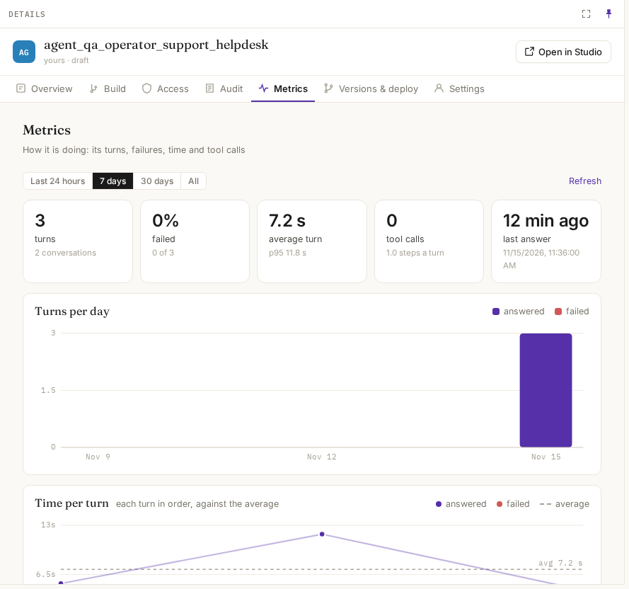

Turns, conversations, failures, average and p95 turn time, tool calls and steps per turn, for the last 24 hours, 7 days, 30 days or all time.

## Versions & deploy

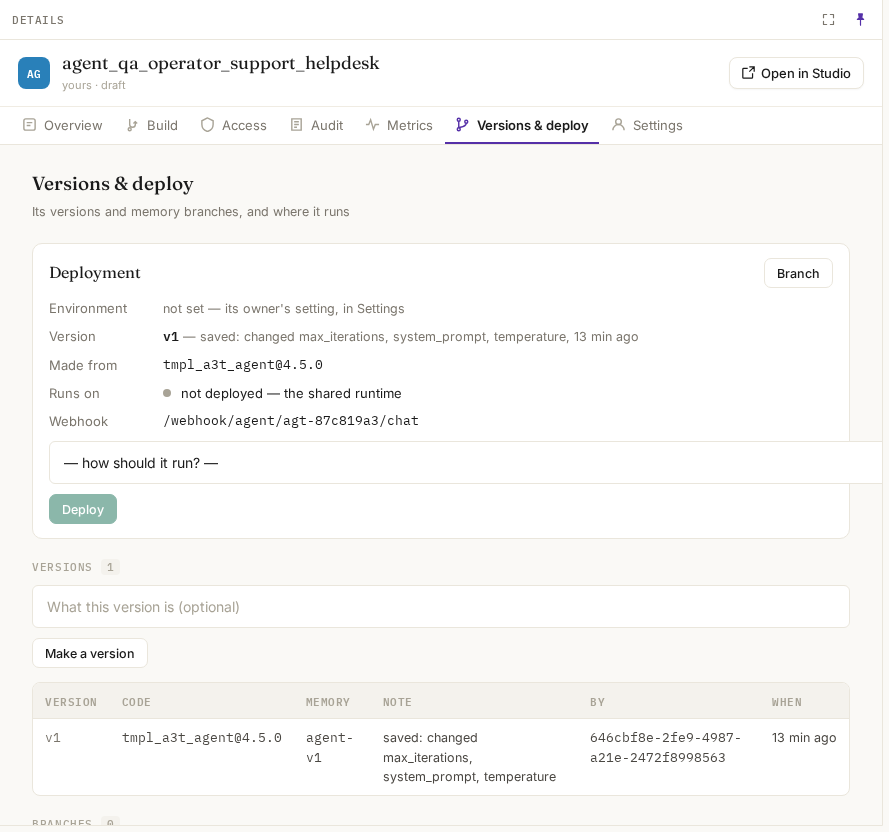

| Section | What it does |
|---|---|
| **Deployment** | Where it runs. Pick a canvas preset (how it should run) and **Deploy** to give it its own runtime; until then it runs on the shared runtime. See [Canvas](../canvas/) |
| **Versions** | Every version: code (template version), a tag on its memory, a note, who and when. A save that changes something makes one; **Make a version** makes one by hand |
| **Branches** | Memory branches. **Try it on this branch** chats with the agent on the branch; **Merge or promote…** shows what the branch changes, then merges it or promotes it to a new agent |
| **Forks** | Agents forked from it |

<Aside type="note">
A merge brings back facts and procedures. A branch that has only been chatted with has no facts or procedures of its own, so it shows nothing to merge.
</Aside>

## Settings

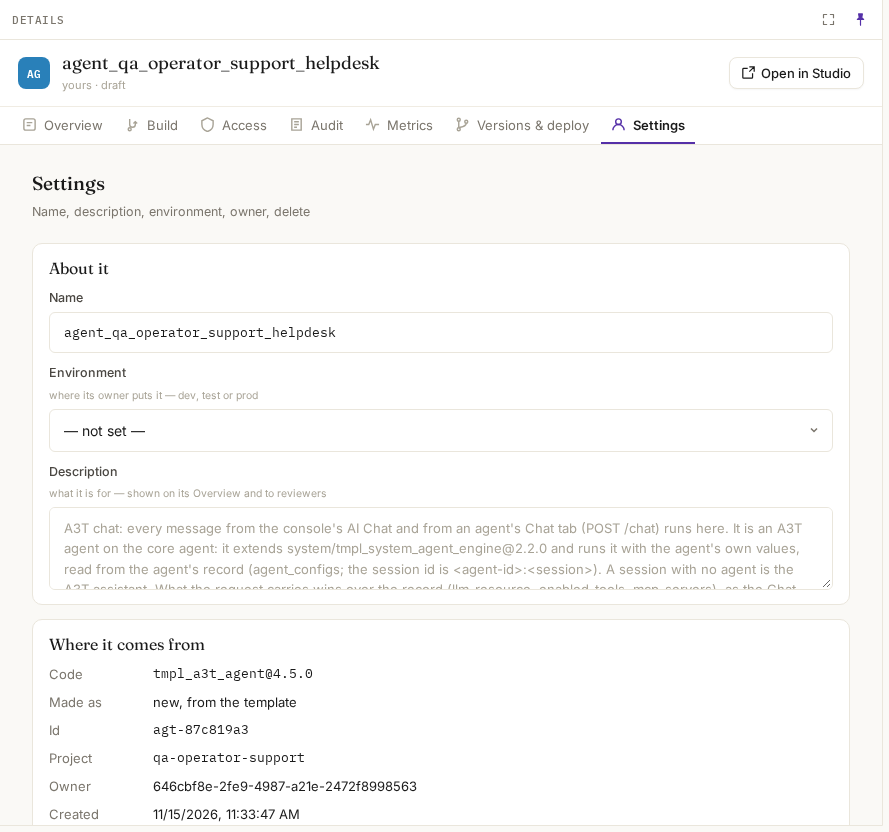

| Field | What it means |
|---|---|
| **Name** | Its name, `agent_<project>_<name>` |
| **Environment** | Where its owner puts it: dev, test or prod |
| **Description** | What it is for, shown on its Overview and to reviewers |
| **Where it comes from** | Its template and version, how it was made, its id, project, owner and creation time |
| **Delete this agent** | Removes the agent, its values, its endpoint (apps calling it get an error) and its own canvas, and revokes its keys. Its template is untouched. Type its name to confirm |

To move an agent to another project, clone it there and delete this one.
