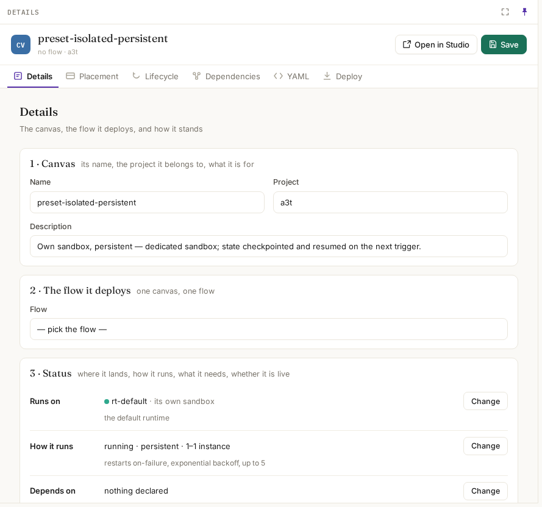
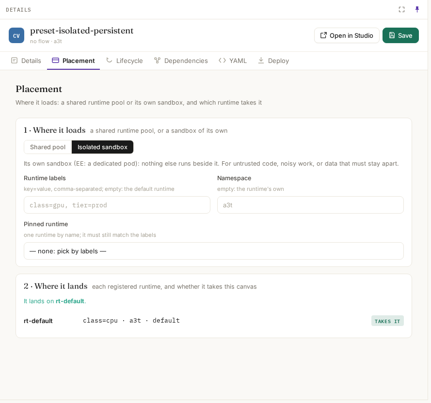
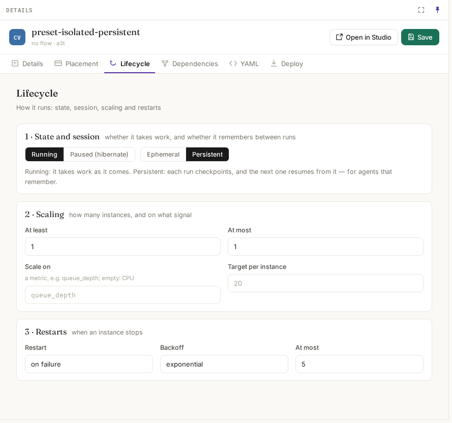
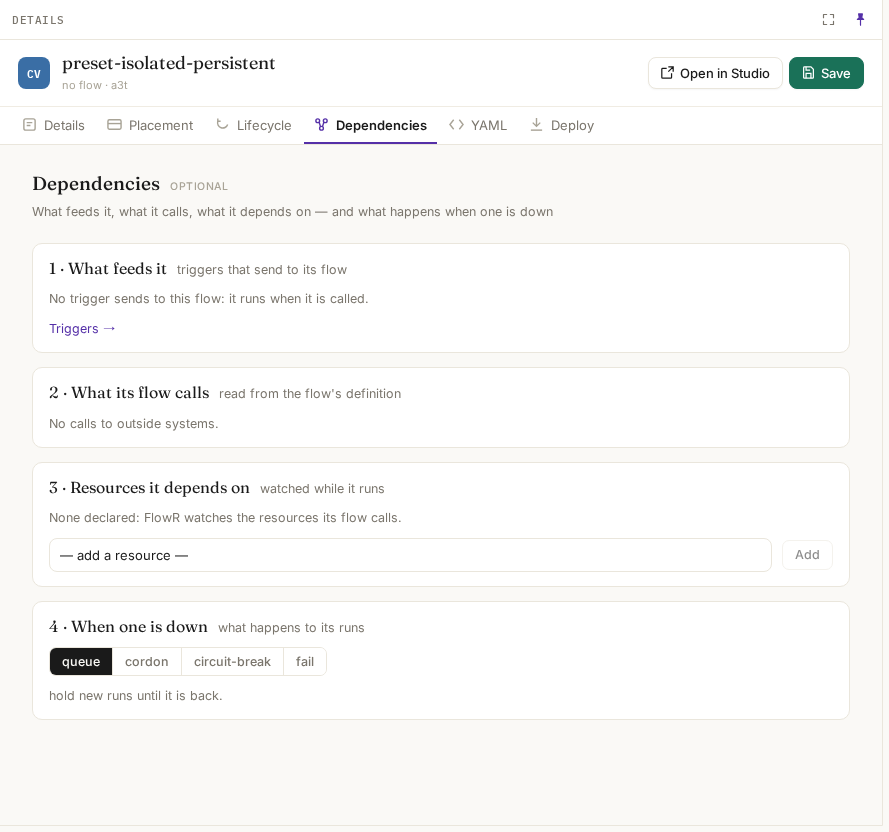
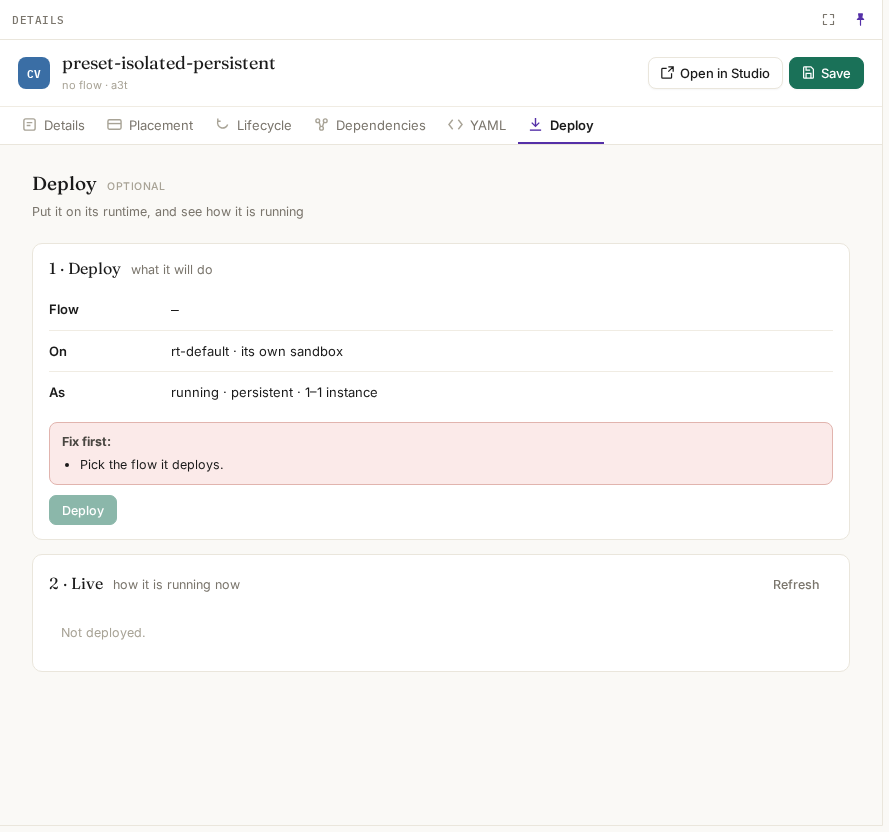

import { Aside } from '@astrojs/starlight/components';

**Open it:** [Canvas](https://dash.a3t.io/canvas) · under **Agents** in the console menu.

A **canvas** says where and how one flow runs once it is **deployed**: in a shared pool or a sandbox of its own, on which runtime, how many copies, whether it remembers between runs, and what happens when something it needs is down. Until it is deployed, an agent or flow runs on the shared runtime inside FlowR, and needs no canvas.

One canvas deploys one flow. An agent's canvas deploys the agent: the agent's own flow, with the agent's settings.

## Presets

A **preset** is a canvas with no flow: a ready-made way to run. To deploy, you copy a preset and bind the copy to your agent or flow.

| Preset | How it runs | Who may use it |
|---|---|---|
| **isolated-ephemeral** | Its own sandbox, a fresh one per run; nothing carried between runs | Admin in the project |
| **isolated-persistent** | Its own sandbox; each run checkpoints, and the next resumes from it | Admin in the project |
| **session-persistent** | For agents that must remember between triggers: state is checkpointed and resumes on the next call | Anyone who may deploy |
| **shared-ephemeral** | In the shared runtime; no state carried between triggers | Anyone who may deploy |
| **prod-shared** | Production, shared pool: 2 to 5 copies, no dedicated runtime | Admin |
| **prod-ha** | Production: a dedicated runtime, 2 to 10 copies, scaled on queue depth | Admin |

"Admin in the project" includes a project's owners and developers; a person with an Operator account who owns the project is Admin there.

## Deploy an agent

The quickest way: on the agent, open **Versions & deploy**, pick a preset under **how should it run?**, and click **Deploy**. A3T copies the preset into the agent's project as the agent's own canvas, binds it to the agent, and deploys it. The agent then shows **deployed on** its runtime, and its own runtime pod takes its work.

**Undeploy** on the same tab stops it and removes its pod; the agent goes back to the shared runtime. Whoever may change the agent's project may deploy and undeploy it.

## The canvas editor

Open a canvas from Items. Six tabs:

### Details

| Field | What it means |
|---|---|
| **Name**, **Project**, **Description** | What it is and where it belongs |
| **Flow** | The one flow it deploys. Empty: it is a preset |
| **Status** | Whether it is deployed, and where |

### Placement

| Field | What it means | Empty means |
|---|---|---|
| **Where it loads** | **Shared pool**: beside other work. **Isolated sandbox**: its own pod, nothing else beside it; for untrusted code, noisy work, or data that must stay apart | — |
| **Runtime labels** | `key=value` pairs, comma-separated, that a runtime must carry to take it, e.g. `class=gpu` | The default runtime |
| **Namespace** | The Kubernetes namespace its pods go in | The runtime's own |
| **Pinned runtime** | One runtime by name. It must still match the labels | Picked by labels |

**Where it lands** lists every runtime and whether it takes this canvas, so you see the result before deploying.

### Lifecycle

| Section | Fields |
|---|---|
| **State and session** | **Running** or **Paused (hibernate)**. **Ephemeral**: nothing carried between runs. **Persistent**: each run checkpoints and the next resumes from it, for agents that remember |
| **Scaling** | **At least** and **At most** copies; **Scale on** a metric such as `queue_depth` (empty: CPU); **Target per instance** |
| **Restarts** | **Restart** on failure, always or never; **Backoff** exponential, linear or fixed; **At most** so many restarts |

### Dependencies (optional)

| Section | What it shows or sets |
|---|---|
| **What feeds it** | The triggers that send to its flow |
| **What its flow calls** | Outside systems, read from the flow's definition |
| **Resources it depends on** | Resources watched while it runs. Empty: FlowR watches the resources its flow calls |
| **When one is down** | **queue**: hold new runs until it is back. **cordon**: take no new runs here; runs elsewhere go on. **circuit-break**: fail fast for a while, then try again. **fail**: fail the runs that need it |

### YAML

The canvas as a graph (where it loads, what it depends on) and as the YAML Studio edits.

### Deploy

**Deploy** shows what will happen (the flow, the runtime and sandbox, how it runs) and lists anything to **fix first**, such as a preset with no flow. **Live** shows how it is running once deployed.

## After deploying

[Runtimes](https://dash.a3t.io/runtime) shows each deployment on its runtime. From there, or from the agent's **Access › Controls**, you can **pause** it (callers get the paused response), **resume**, **restart** or **undeploy** it.

<Aside type="caution">
A canvas can't be deleted while a deployment uses it, or while the agent it is bound to still exists. Undeploy it, or delete the agent, first.
</Aside>
