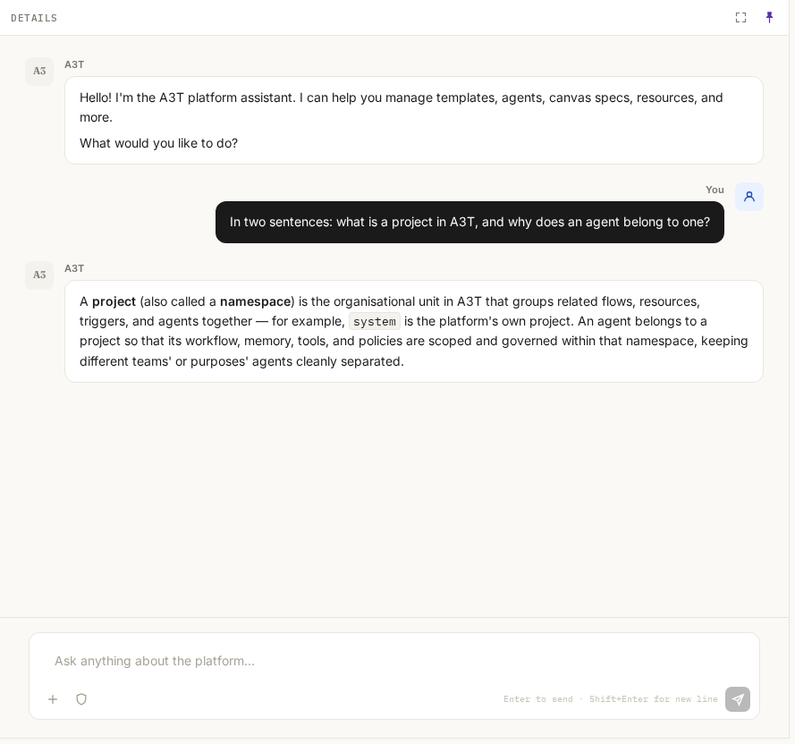
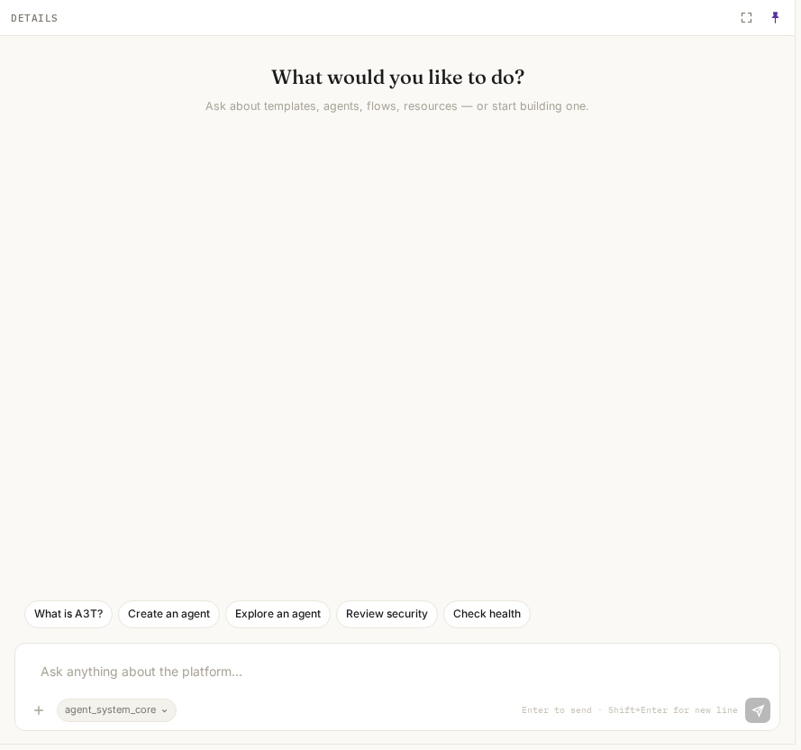

import { Aside } from '@astrojs/starlight/components';

**Open it:** [AI Chat](https://dash.a3t.io/chat) · first item in the console menu.

AI Chat is where you talk to A3T's own assistant: ask how something works, what is in a project, or ask it to build something for you. It is a test bench for people working in the console. Your users don't use it; your apps call your agents directly, as in the [Quick start](../../getting-started/quickstart/).

## What you can do

| On the page | What it does |
|---|---|
| **What would you like to do?** | Five starting points on an empty conversation: **What is A3T?**, **Create an agent**, **Explore an agent**, **Review security**, **Check health**. Each starts a question or opens the app that answers it |
| The message box | Type and press **Enter** to send; **Shift+Enter** starts a new line. The answer streams in as it is written |
| **New conversation** (Items) | Starts a clean conversation. Earlier ones stay in the Items list, newest first, with their message count |
| Filter conversations | Finds a conversation by its first message |

Conversations are kept on the server, under your account, so they follow you to another browser. Nobody else sees them, except Platform InfoSec (SuperAdmin, SecurityAdmin) reviewing an incident.

## Chat beside any app

Every app's middle pane has an **Items | Chat** switch. **Chat** puts a conversation beside whatever is open in Details, and each message tells the assistant where you are: the app, the item and its settings. You can ask "why is this trigger not firing?" with the trigger open, without pasting anything.

## Which agent answers

| Who you are | Which agent answers |
|---|---|
| Most people | The A3T assistant. There is no agent picker |
| SuperAdmin, or an admin of the `a3t` organisation | Any A3T agent, chosen with the picker under the message box |

<Aside type="note">
To try **your own** agent, use its **Overview › Test it** on the [Agents](https://dash.a3t.io/agents) page. That sends messages as you, on the same endpoint your apps use.
</Aside>

## What the assistant may do

The assistant acts as **you**: everything it does is checked against your role and your projects, the same as if you clicked it yourself. If you are a Viewer, it can explain and read, but it can't create or change anything for you. Every action it takes is recorded in the [Decision log](https://dash.a3t.io/logs) with your name.

## Example

Ask: *"In two sentences: what is a project in A3T, and why does an agent belong to one?"*

> A project (also called a namespace) is the organisational unit in A3T that groups related flows, resources, triggers, and agents together — for example, `system` is the platform's own project. An agent belongs to a project so that its workflow, memory, tools, and policies are scoped and governed within that namespace, keeping different teams' or purposes' agents cleanly separated.
