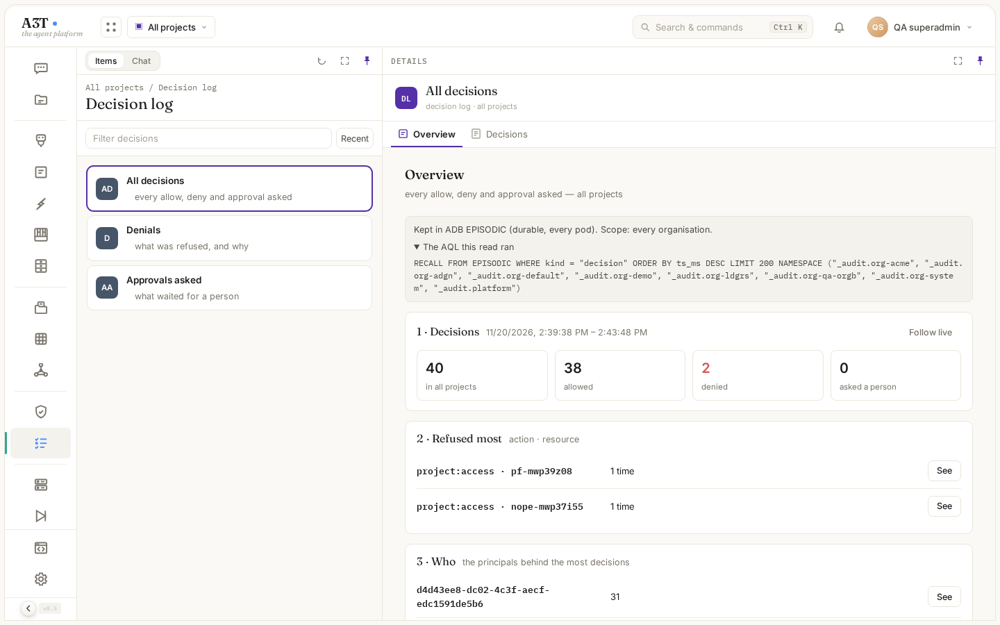

**Open it:** [Decision log](https://dash.a3t.io/logs) · under **Security & audit** in the console menu.

Each time a person or an agent tries to do something, A3T decides whether it may, and writes the decision down: who, on whose behalf, which agent and version, what action on what, allowed or denied, which policy decided and why. The Decision log is where you read them. It shows the project picked in the top bar; pick **All projects** to see everything.

## Where it is kept

Every FlowR pod writes its decisions to ADB, in EPISODIC memory, about once a second. A pod restart loses nothing, and every pod's decisions are in one log. Each organisation has its own log (namespace `_audit.<org id>`); decisions about platform-wide calls and personal projects are in `_audit.platform`. No project, flow or agent can name these namespaces.

The page shows the AQL each read ran (**The AQL this read ran**), for example:

```sql
RECALL FROM EPISODIC WHERE kind = "decision" AND decision = "deny"
  ORDER BY ts_ms DESC LIMIT 200 NAMESPACE ("_audit.org-acme", "_audit.platform")
```

Tick **by meaning** to search by description instead of exact words (`RECALL FROM EPISODIC LIKE …`), for example *who changed agent policies today*.

## Who sees what

| You are | You see |
|---|---|
| **SuperAdmin**, **SecurityAdmin** | Every organisation's decisions |
| An organisation's **admin** or **security admin** | That organisation's decisions |
| Anyone else | The decisions about the agents you own |

Items has three views:

| View | What it lists |
|---|---|
| **All decisions** | Every allow, deny and approval asked |
| **Denials** | What was refused, and why |
| **Approvals asked** | What waited for a person to approve it |

## Overview



| Section | What it shows |
|---|---|
| **Decisions** | The time span covered; how many in total, allowed, denied and asked. **Follow live** keeps adding new ones |
| **Refused most** | The action and resource refused most often, with **See** to list them |
| **Who** | The principals behind the most decisions |

## Decisions


Each line: allowed (✓), denied (✕) or asked (?); **who** · the **action** and its **resource**; the reason, naming the policy; and when. The decision and the person filter on the server; the text box filters what is loaded, or searches by meaning. **Older decisions** loads the next page.

Open a line for everything recorded about it:

| Field | Example |
|---|---|
| Decision | `deny` |
| Principal, and who it acted for | an agent, for `qa-operator@a3t.io` |
| Agent | `agt-support` · version `3` · owner `u-123` |
| Action and resource | `mcp:call` · Tool `delete_flow` |
| Project and organisation | `acme-web` · `org-acme` |
| Roles | the roles the principal carried into the decision |
| Policies | `qa-operator-support/no-flow-deletes` · set `9f2c41d07a1b33e8` (the version of the policy set that decided) |
| When and where | the time, and the FlowR pod |

When a SuperAdmin used **Act as**, the line also shows **acted by** with the SuperAdmin's name, and starting shows the reason they gave.

## What else is in it

Besides policy decisions, the log records:

- an approval answered (who, and what they answered);
- a refusal by project isolation (someone reaching a project they can't see);
- someone reading another person's conversation;
- an org policy file saved, deleted, or switched on or off;
- an agent's policy saved or deleted;
- an agent key created or revoked;
- **Act as** started (with its reason) and stopped.

## Finding why something was refused

1. Pick **Denials**, and the project in the top bar.
2. Filter by the person, or type the resource, e.g. `delete_flow`.
3. The reason names the policy, and the set version says exactly which rules were in force. Open the policy in [Security](https://dash.a3t.io/security), and use its **Test** tab to check a change before saving it.

An agent's own **Audit** tab shows the decisions about that agent, matched by its id.
