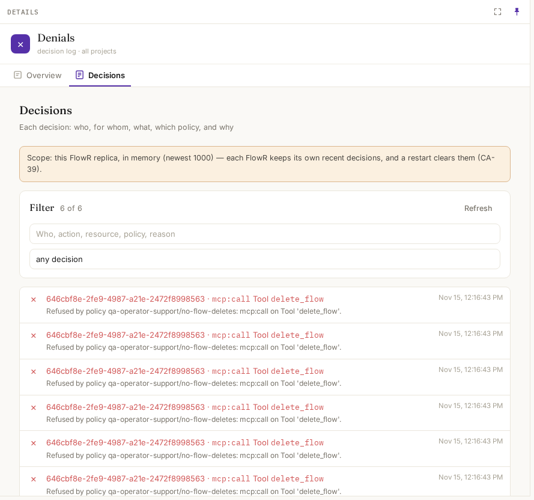

**Open it:** [Decision log](https://dash.a3t.io/logs) · under **Security & audit** in the console menu. For **SuperAdmin** and **SecurityAdmin** only.

Each time a person or an agent tries to do something, A3T decides whether it may, and writes the decision down: who, on whose behalf, what action on what, allowed or denied, which policy decided and why. The Decision log is where you read them. It shows the project picked in the top bar; pick **All projects** to see everything.

Items has three views:

| View | What it lists |
|---|---|
| **All decisions** | Every allow, deny and approval asked |
| **Denials** | What was refused, and why |
| **Approvals asked** | What waited for a person to approve it |

## Overview

| Section | What it shows |
|---|---|
| **Decisions** | The time span covered; how many in total, allowed, denied and asked. **Follow live** keeps adding new ones |
| **Refused most** | The action and resource refused most often, with **See** to list them |
| **Who** | The principals behind the most decisions |

## Decisions

Each line: allowed (✓), denied (✕) or asked; **who** · the **action** and its **resource**; the reason, naming the policy; and when. Filter by text or by kind (**any decision**, **allowed**, **denied**, **asked**).

| Field | Example |
|---|---|
| Who | the person's id, and the agent if one acted for them |
| Action and resource | `mcp:call` · Tool `delete_flow` |
| Reason | `Refused by policy qa-operator-support/no-flow-deletes: mcp:call on Tool 'delete_flow'.` |

When a SuperAdmin used **Act as**, the line also shows **acted by** with the SuperAdmin's name.

## Finding why something was refused

1. Pick **Denials**, and the project in the top bar.
2. Filter by the resource or the person, e.g. `delete_flow`.
3. The reason names the policy. Open it in [Security](https://dash.a3t.io/security), and use its **Test** tab to check a change before saving it.

An agent's own **Audit** tab shows the decisions about that agent.
