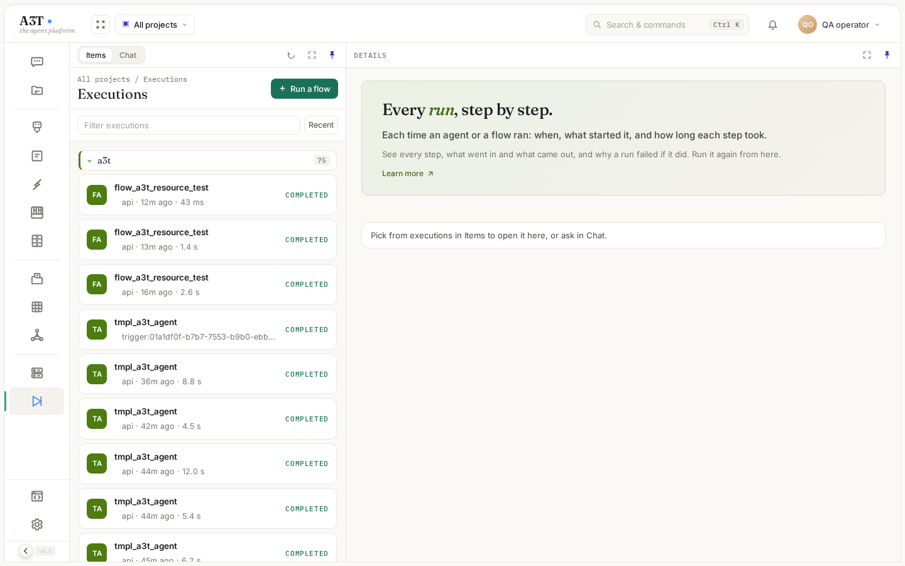
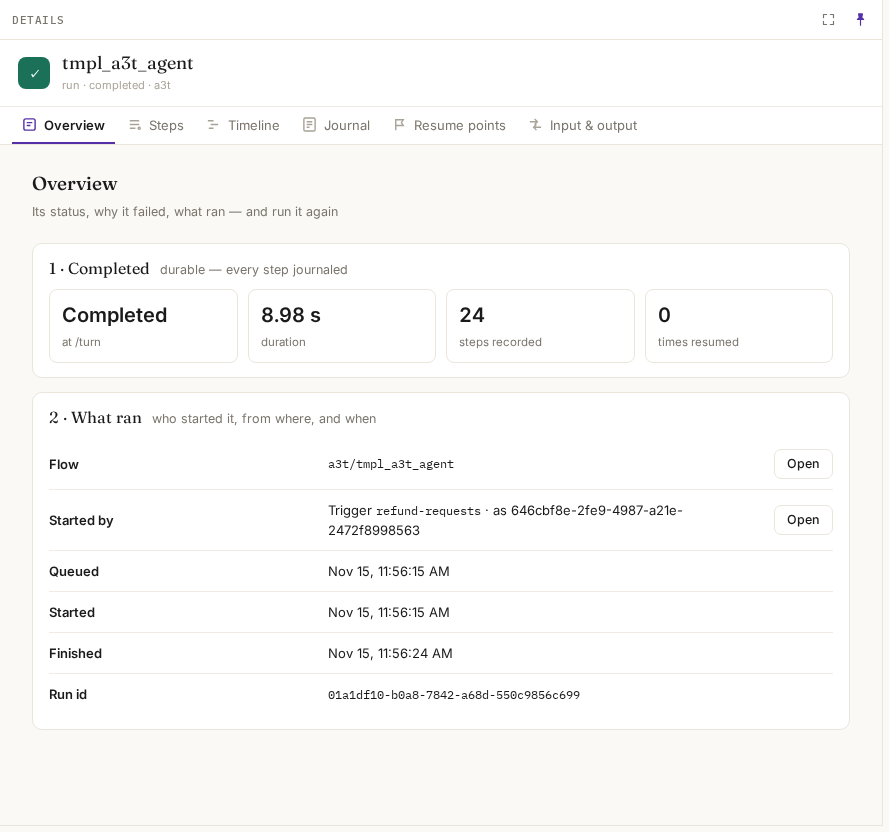
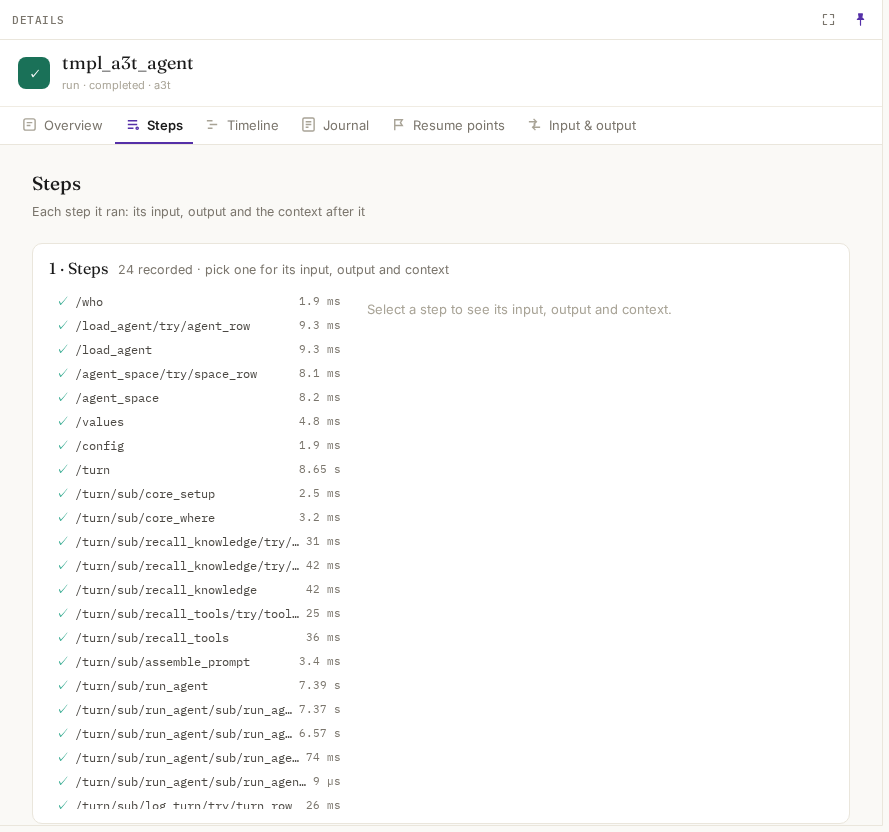
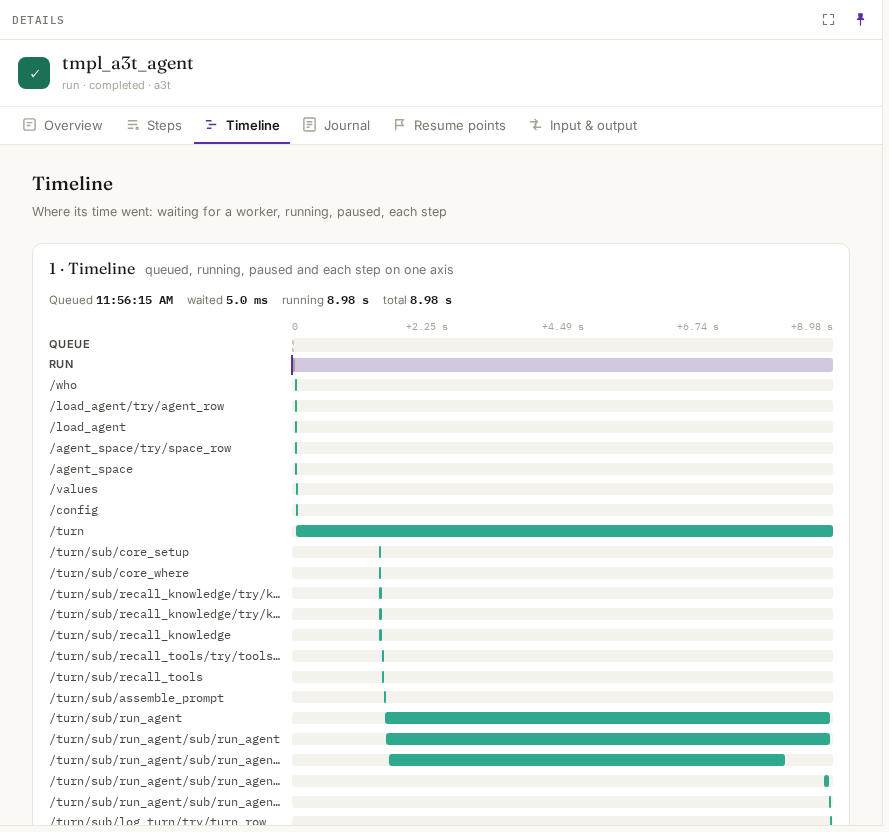

**Open it:** [Executions](https://dash.a3t.io/executions) · under **Runtimes & runs** in the console menu.

Every agent turn and every flow run is an **execution**: a run of a flow, kept with each of its steps. Items lists runs newest first, each with its flow, what started it, how long ago, how long it took and how it ended (**completed**, **failed**, **running**, **paused**, **cancelled**). It shows the runs of the project picked in the top bar that you may see: a project's runs to its members, and your own runs of platform flows.

## A run

| Tab | What it shows |
|---|---|
| **Overview** | Its status and duration, how many steps were recorded and how often it resumed; **why it failed**, if it did, with the error each step gave; **What ran**: the flow, **Started by**, when it was queued, started and finished, and its run id. **Run again** starts it with the same input |
| **Steps** | Each step it ran, with its time. Pick one for its input, output and the context after it |
| **Timeline** | Where the time went: waiting for a worker, running, paused, and each step, on one axis |
| **Journal** | The durable record of each step, which is what lets a run resume after a restart |
| **Resume points** | Where it can resume from |
| **Input & output** | What it was started with, and what it gave |

### Started by

| What started it | Shown as |
|---|---|
| A trigger | **Trigger** `<name>`, with **Open**; a schedule shows **Schedule of trigger** `<name>` |
| A turn of an agent | **A turn of agent** `<id>`, for the person it acted for, with **Open** |
| An app or a person through the API | `api`, and who |

### Steps

Step paths show where each step sits in the flow: `/load_agent/try/agent_row` is the `agent_row` step inside the `try` of `load_agent`; `/turn/sub/…` are the steps of a subflow `turn` runs; `for[0]` is the first pass of a loop.

### Timeline

## Example

The trigger test on the [Triggers](../triggers/#5-test) page started run `01a1df10-…`: the help-desk agent's turn, **Started by Trigger refund-requests**. It completed in 8.98 s over 24 steps; nearly all of it was `/turn`, the model call. Its **Input & output** tab shows the mapped message and the agent's answer.
