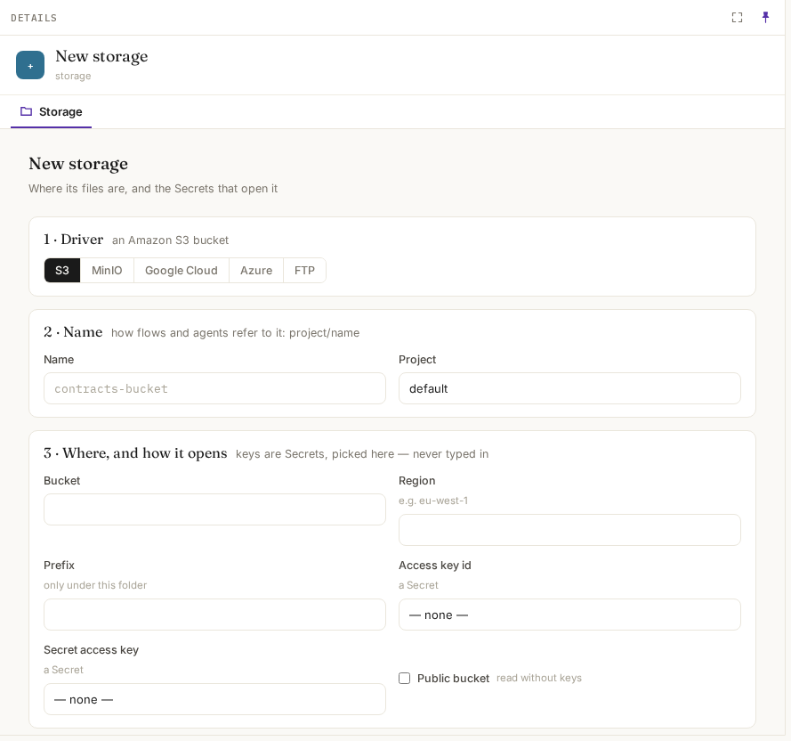

import { Aside } from '@astrojs/starlight/components';

**Open it:** [Files](https://dash.a3t.io/data-rooms) · first item under **Knowledge & data** in the console menu.

**Files** connects cloud storage and file servers to A3T, so agents and flows can read and write files in them, and you can browse what is there. Each one is a **storage** resource in a project, used by name like any other resource.

## New storage

**1 · Driver**: where the files are. **2 · Name** and **Project**: flows and agents refer to it as `<project>/<name>`. **3 · Where, and how it opens**: the driver's fields. Keys are always **Secret** resources, picked from a list; they are never typed into the storage itself.

| Driver | Fields (empty means) |
|---|---|
| **S3** (an Amazon S3 bucket) | **Bucket**; **Region** (e.g. `eu-west-1`); **Prefix** (only under this folder; empty: the whole bucket); **Access key id** and **Secret access key** (Secrets); **Public bucket** (read without keys) |
| **MinIO** (an S3-compatible bucket) | **Endpoint** (e.g. `http://minio.example:9000`); **Bucket**; **Region** (`us-east-1` if unsure); **Prefix**; **Access key** and **Secret key** (Secrets) |
| **Google Cloud** | **Bucket**; **Prefix**; **Service account key** (a Secret holding the key JSON); **Public bucket** |
| **Azure** (a Blob container) | **Storage account**; **Container**; **Prefix**; **Access key** (a Secret) |
| **FTP** | **Host**; **Port** (`21`); **User** (empty: anonymous); **Password** (a Secret); **Root directory** (empty: `/`) |

**Create storage** saves it. Create the Secrets first, in [Resources](https://dash.a3t.io/resources).

## A storage's tabs

| Tab | What it shows |
|---|---|
| **Overview** | Where it points, which Secrets open it, and who uses it |
| **Files** | Its contents, through its own driver: a bucket's folders and files, or an FTP server's directories. Open a file to see its first 64 KiB |
| **Used by** | The agents, flows, canvases and triggers that name it |
| **Configuration** | Its driver's settings; credentials as Secret references only |
