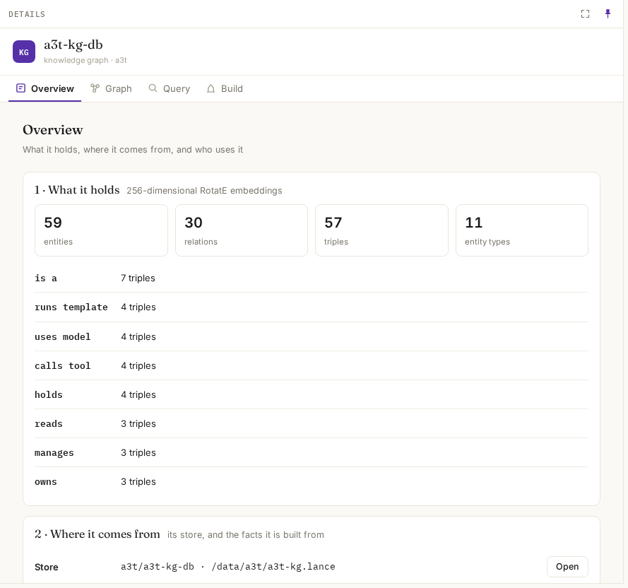
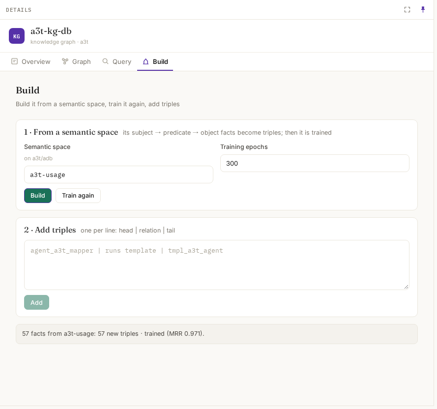
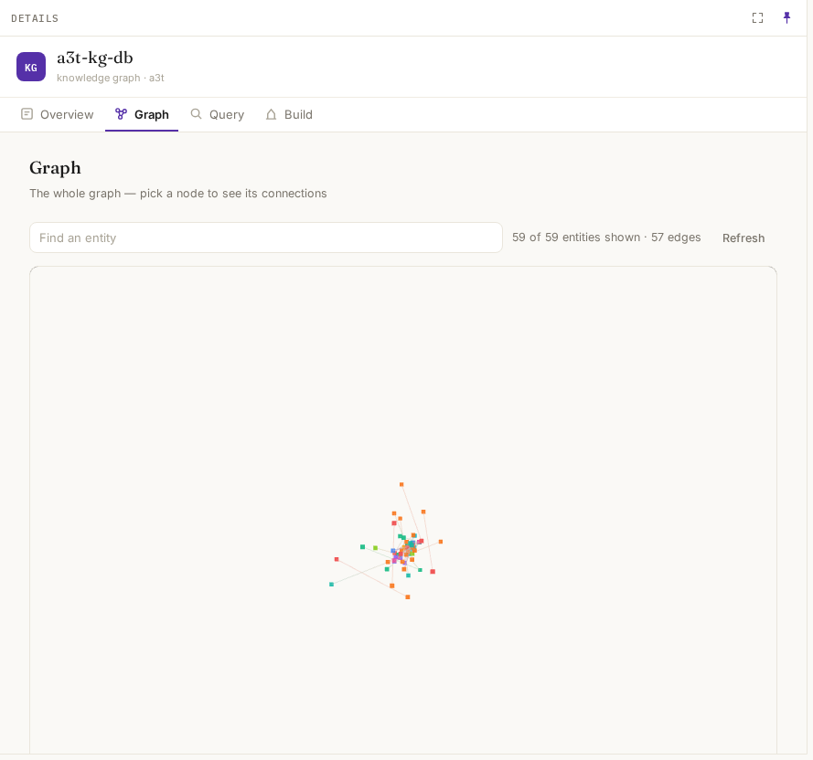

import { Aside } from '@astrojs/starlight/components';

**Open it:** [Knowledge](https://dash.a3t.io/knowledge) · under **Knowledge & data** in the console menu.

A **knowledge graph** is a map of things (agents, models, tools, organisations…) and how they are linked, built from **facts**: subject → predicate → object entries in a **semantic space** in ADB. A3T stores the graph's triples and trains **RotatE** embeddings on them, so it can also suggest links that are likely but missing.

Each graph has four tabs.

## Overview

| Section | What it shows |
|---|---|
| **What it holds** | Counts of entities, relations, triples and entity types; the most used relations; the embedding size |
| **Where it comes from** | Its **store** and the semantic space it was **built from** |
| **Used by** | The agents, flows, canvases and triggers that name it |

## Build

| Section | What it does |
|---|---|
| **From a semantic space** | Pick a **semantic space** in ADB and the **training epochs**, then **Build**: every subject → predicate → object fact becomes a triple, and the embeddings are trained. **Train again** retrains on what it holds |
| **Add triples** | One per line, `head \| relation \| tail` |

Building `a3t-kg-db` from the `a3t-usage` space gave: *57 facts from a3t-usage: 57 new triples · trained (MRR 0.971)*. MRR (mean reciprocal rank) measures how well the embeddings rank the true links; 1.0 is perfect.

## Graph

Every entity is a point, placed by its embedding (related things sit close together) and coloured by its type. **Find an entity** jumps to it; pick a point to see its connections.

## Query

| Section | What it does |
|---|---|
| **Triples** | Find triples by head, relation and tail; leave any empty. E.g. relation `uses model` lists which agent uses which model |
| **Predict** | The likeliest tails for a head and a relation, from the embeddings: a link that is probably true but not yet stated |
| **AQL on its source** | Read the facts it was built from, in ADB (`RECALL` only) |

## Agents and knowledge

An agent reads shared knowledge from the semantic spaces **attached** to it (agent **Build › Memory**). The graph is built from the same facts; rebuild it after the facts change.
