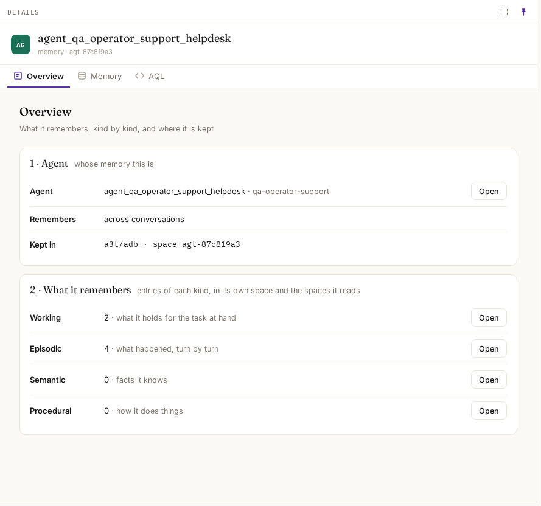
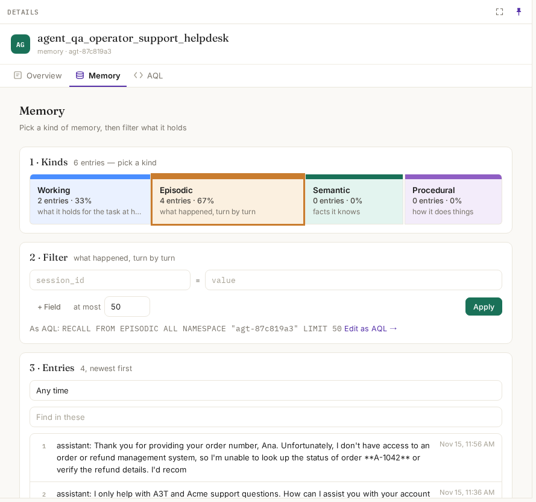
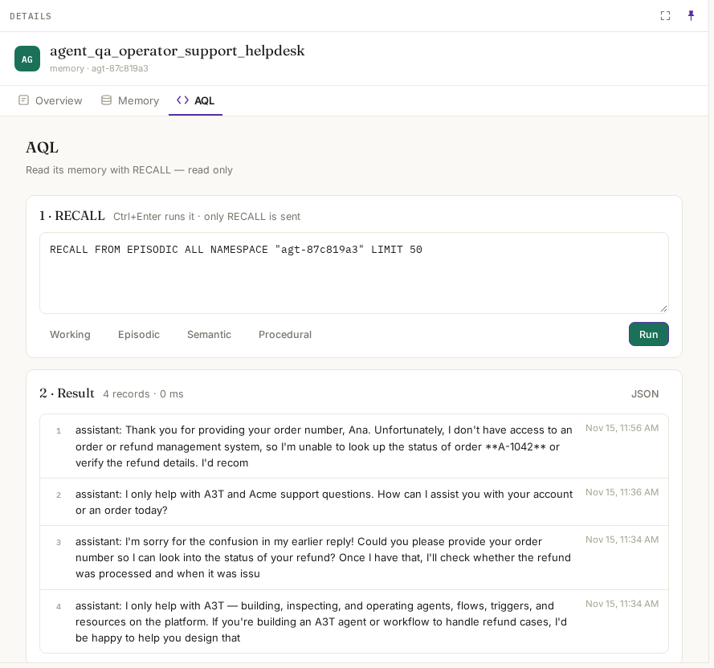

import { Aside } from '@astrojs/starlight/components';

**Open it:** [Memory](https://dash.a3t.io/memory) · under **Knowledge & data** in the console menu.

Every agent has its own **memory space** in ADB, A3T's agent database. Memory is where you read it, across all your agents. To change what an agent remembers, use the agent's own **Build › Memory** (see [Agents](../agents/#memory)); here it is read only.

Items lists your agents with how each remembers: across conversations, one conversation, or nothing. Pick one; it has three tabs.

## Overview



| On the page | What it means |
|---|---|
| **Agent** | Whose memory it is, with a link to the agent |
| **Remembers** | Across conversations, one conversation, or nothing |
| **Kept in** | The ADB resource and the space, e.g. `a3t/adb · space agt-87c819a3`. Each agent has a space of its own |
| **What it remembers** | How many entries of each kind, in its own space and in the shared spaces it reads |

| Kind | What it holds |
|---|---|
| **Working** | What it holds for the task at hand |
| **Episodic** | What happened: its turns, one by one, with their conversation |
| **Semantic** | Facts it knows: subject, predicate, object |
| **Procedural** | How it does things: steps it has learned |

## Memory



1. **Kinds**: pick a kind of memory. Each shows its count and share.
2. **Filter**: narrow by field (`=` a value), and set **at most** how many to read. **Apply** reads them; the filter is shown **As AQL**, and **Edit as AQL** opens it on the AQL tab.
3. **Entries**: newest first. Narrow them further by time (**Any time**, **Last hour**, **Last 24 hours**, **Last 7 days**, **Last 30 days**) and by text (**Find in these**). The count shows how many of how many match.

## AQL



Read its memory with **AQL**, the Agent Query Language. Only `RECALL` runs here (**Ctrl+Enter**); writes are refused. The buttons fill in a RECALL for each kind:

```sql
RECALL FROM EPISODIC NAMESPACE "agt-87c819a3" LIMIT 50
```

The result shows the records and how long the query took, as a list or as **JSON**. The full language is in [AQL](../../concepts/aql/).

## Example

The help-desk agent from the [Quick start](../../getting-started/quickstart/) has answered four times. Its **Episodic** memory holds each answer, with its conversation:

| # | Entry | When |
|---|---|---|
| 1 | assistant: Thank you for providing your order number, Ana. … | Nov 15, 11:56 |
| 2 | assistant: I only help with A3T and Acme support questions. … | Nov 15, 11:36 |
| 3 | assistant: I'm sorry for the confusion in my earlier reply! … | Nov 15, 11:34 |

<Aside type="note">
Memory is kept per agent and survives restarts and redeploys. Forgetting an entry (on the agent's **Build › Memory**) removes it from every read at once; the forget is recorded in the agent's history, and the entry's history is kept.
</Aside>
