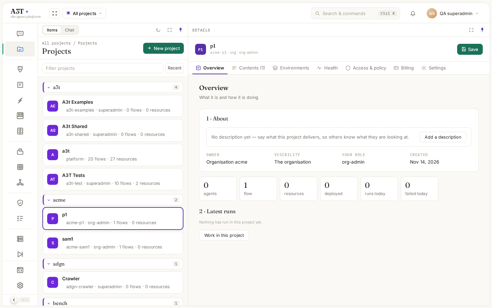
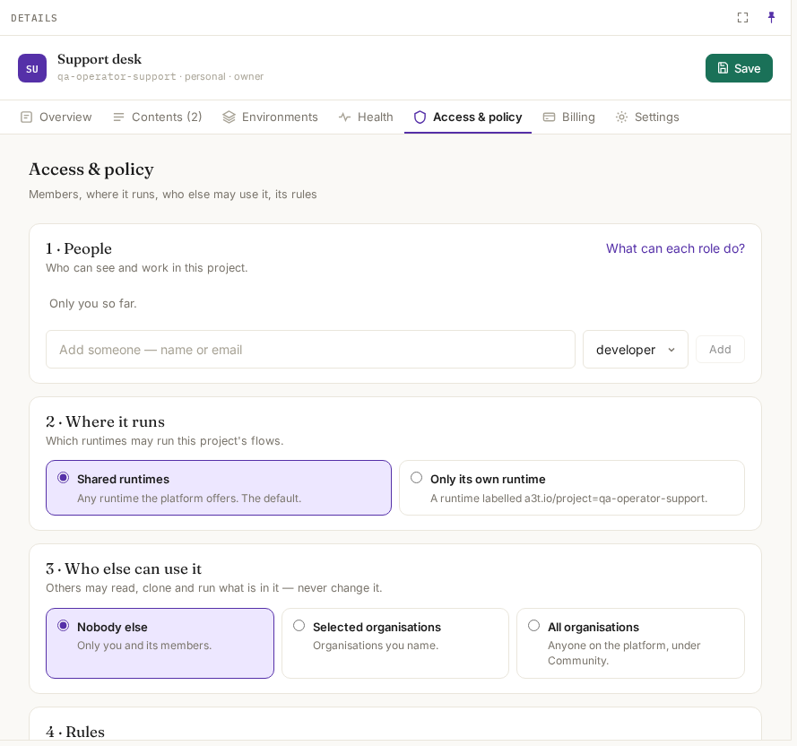
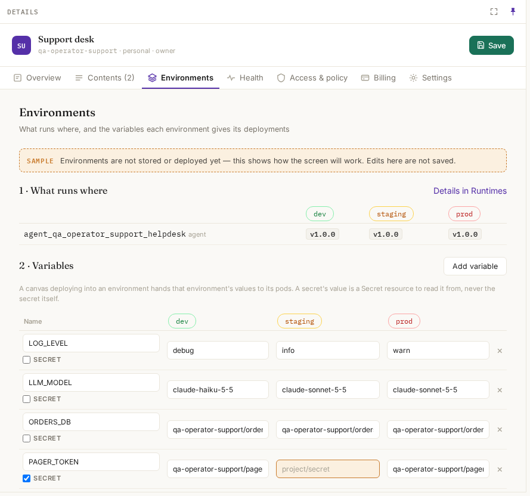
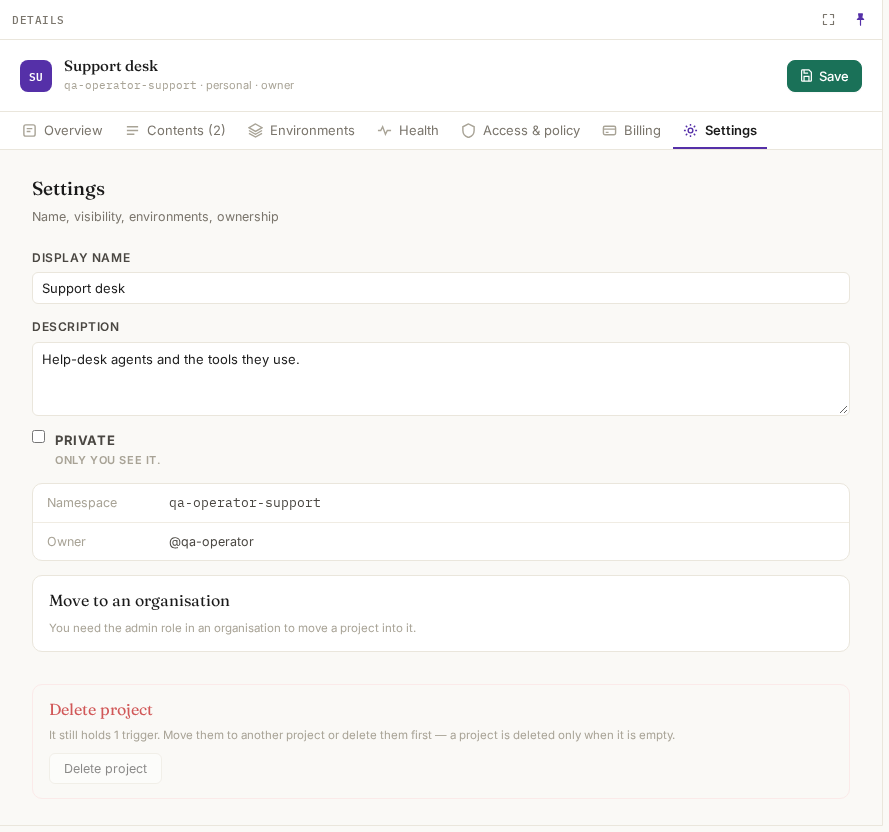

import { Aside } from '@astrojs/starlight/components';

**Open it:** [Projects](https://dash.a3t.io/projects) · second item in the console menu.

A **project** holds a team's work: its agents, templates, flows, triggers, resources and canvases. Everything in A3T belongs to exactly one project, and the project decides who can see it and who can change it. A project is either **personal** (yours) or an **organisation's**.

Items lists your projects grouped by **owner**: your handle first, then your organisations, then the platform's. The **project picker** in the top bar narrows every app to one project; the address then starts with `/p/<project>/`, so a link opens in the same project for whoever follows it.

## Personal and organisation projects

| | Personal project | Organisation project |
|---|---|---|
| **Owner** | You, by your handle | An organisation you are a member of |
| **Namespace** | `<your-handle>-<name>`, e.g. `qa-operator-support` | `<org>-<name>`, e.g. `acme-support` |
| **Who can create it** | Anyone with the Operator role or higher | An admin or member of that organisation |
| **Who can see it** | You and the members you add | Its members, the organisation's admins and security admins, and every member of the organisation unless it is **private** |
| **Who can change it** | You, and members with the owner or developer role | Its owners and developers, and the organisation's admins |
| **Private** | Only you and its members | Only its members and the organisation's admins and security admins |

Two projects belong to the platform: **a3t** (A3T's own agents, flows and shared resources) and **system** (the core agent and A3T's internals). Everyone can read them and clone from them; only a SuperAdmin can change them.

## Members and roles

Add people on **Access & policy › People**. Type a name or email: everyone who can sign in is listed, including people who sign in through their organisation's own identity provider (marked **SSO**).

| Project role | What they can do |
|---|---|
| **owner** | Everything, including members, rules, moving and deleting the project |
| **developer** | Build and run: agents, templates, flows, triggers, resources, canvases |
| **operator** | Deploy and run what is there; no authoring |
| **viewer** | Read only |

A person's **account role** is the ceiling. Someone whose account is a **Viewer** stays read-only in every project, even if a project makes them an owner. Removing a member takes effect on their next request.

<Aside type="note">
**Organisation roles.** An organisation's **admins** can change all of its projects, **security admins** can read them, and **members** can read the ones that aren't private. People who sign in through the organisation's own identity provider get their organisation role from it each time they sign in; see [Settings](../settings/).
</Aside>

## Sharing with other organisations

**Access & policy › Who else can use it** lets people outside the project **read, clone and run** what is in it, never change it.

| Choice | Who gets it | How they see it |
|---|---|---|
| **Nobody else** (default) | Only the project's own people | — |
| **Selected organisations** | The organisations you name | As **community** items in their lists |
| **All organisations** | Everyone on the platform | As **community** items |

The platform's own projects share differently: what `a3t` shares appears as **shared** (to use or wire in) or **training** (examples to learn from and clone), and `system` shares only with `a3t`.

## The project's tabs

| Tab | What it shows |
|---|---|
| **Overview** | Its description, owner, visibility, your role; counts of agents, flows, resources and deployments; runs today and failures; the latest runs |
| **Contents** | Every agent, flow, template, resource, trigger and canvas in it, each with a link |
| **Environments** | What runs where, and each environment's **variables** (dev, staging, prod) |
| **Health** | Its deployments and the runs that failed in the last 24 hours |
| **Access & policy** | People, where it runs, who else can use it, its rules |
| **Billing** | Who pays and its budget. Sample data until billing is connected |
| **Settings** | Display name, description, private; move to an organisation; delete |

### Environments and variables

A variable has a value per environment. When a canvas deploys into an environment, its pods get that environment's values. A **secret** variable names a Secret resource to read the value from; the secret itself is never stored in the project.

### Where it runs

| Choice | Meaning |
|---|---|
| **Shared runtimes** (default) | Any runtime the platform offers |
| **Only its own runtime** | Only a runtime labelled `a3t.io/project=<namespace>` (an org project's choice: `a3t.io/org=<org>`) |

### Rules

The three ready-made rules (only owners deploy to prod; destructive tools need an owner; agents remember per user) are saved with the project but **not enforced yet**. To enforce a rule today, a security admin writes a Cedar policy for the project in [Security](https://dash.a3t.io/security).

## Move and delete

| Action | Who | What happens |
|---|---|---|
| **Move to an organisation** | The owner of a personal project, who is an admin of the target organisation | The namespace becomes `<org>-<name>`. Its flows, resources and triggers move with it, and references inside the project are rewritten. **Preview** lists anything outside the project that refers to it and would break. Run history stays under the old name |
| **Change organisation** | — | Not available yet: an organisation's project can't move to another organisation |
| **Delete project** | Its owner, or an admin of its organisation | Only when it is empty. Move or delete its agents, flows, resources and triggers first. Removes the project, its members and its rules; run history stays |

## Example

The Support desk team at Acme starts in a personal project and moves to the organisation when it goes live:

1. Ann makes the personal project `ann-support` and builds her help-desk agent there.
2. She adds Sam as **developer** on **Access & policy › People**. Sam signs in with Acme's own identity provider, so he is listed as SSO.
3. When it is ready, Ann opens **Settings › Move to an organisation**, picks `acme`, checks **Preview**, and moves it. It is now `acme-support`; Acme's admins can manage it and every Acme member can read it.
4. To let Globex try the agent without changing it, Ann sets **Who else can use it** to **Selected organisations: globex**.
