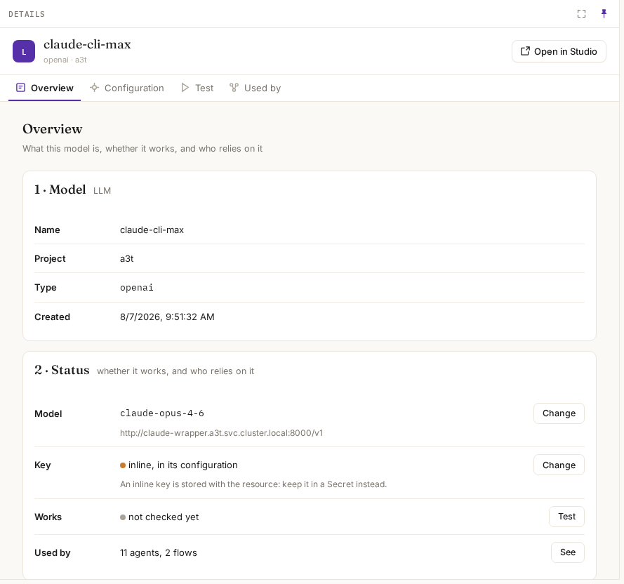
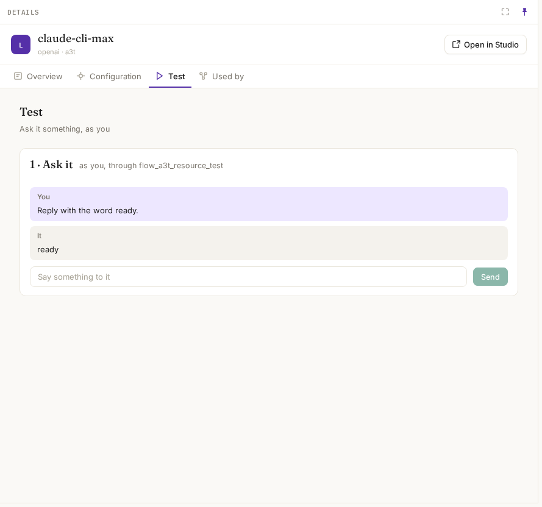
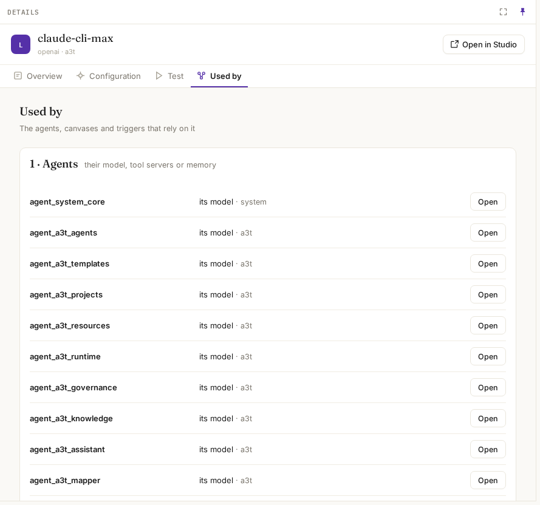
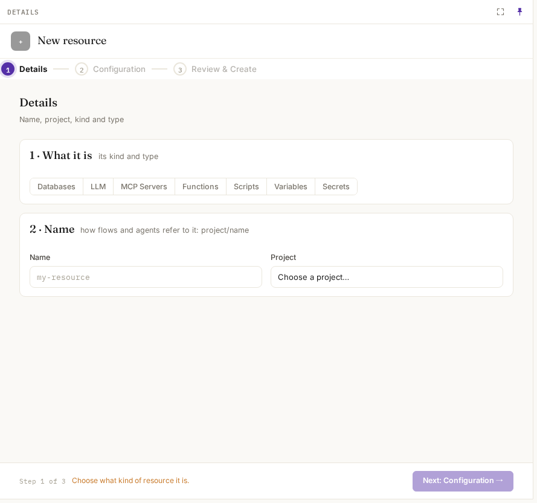

import { Aside } from '@astrojs/starlight/components';

**Open it:** [Resources](https://dash.a3t.io/resources) · under **Agents** in the console menu.

A **resource** is a connection to something outside A3T: a model, an MCP tool server, a database, a secret. You set it up once, in a project, and agents and flows use it by its name, `<project>/<name>`. Its address, keys and options live in one place, so changing them changes every agent and flow that uses it.

Items groups resources by kind:

| Kind | Types | Used for |
|---|---|---|
| **LLM** | `openai` (any OpenAI-style API), `anthropic`, `ollama`, `groq`, `llm` | An agent's **Model**; `call: llm` in a flow |
| **MCP Servers** | `mcp` | An agent's **Tools**; `call: mcp` in a flow |
| **Databases** | `adb`, `lancedb`, `postgres`, `mysql`, `redis`, `qdrant` | Memory (ADB), A3T's own data, a flow's queries |
| **Secrets** | `secret`, `credential` | Keys and passwords other resources read, never shown again once saved |
| **Variables** | `variable` | A named value flows read |
| **Functions**, **Scripts** | `function`, `script` | Code a flow calls |
| **Flows** | — | The flows in the project, listed here too |

Platform resources (the shared models, ADB, A3T's own databases) are in the `a3t` project. Everyone can use them; only a SuperAdmin can change them. Turn on **show platform** to list them.

## A resource's tabs

| Tab | What it shows |
|---|---|
| **Overview** | What it is (name, project, type, created); **Status**: its main settings, where its key is kept, whether it works, and what relies on it; **Delete** |
| **Configuration** | Its settings, as a form (or **Show as JSON**). **Save** applies them to the next call |
| **Test** | Calls it, as you, and shows the answer, the time it took, or the service's own error |
| **Used by** | Every agent, flow, resource, canvas and trigger that names it |

## Configuration, by kind

### LLM

| Field | What it means | Example |
|---|---|---|
| **API URL** | The base URL requests are sent to | `https://api.openai.com/v1` |
| **Model** | The model name the provider expects | `gpt-4o-mini` |
| **Provider** | Its API style: `openai` for any OpenAI-compatible API, or `anthropic` | `openai` |
| **Key** | **From a secret**: the name of a Secret resource holding it (recommended). Or inline, stored with the resource | `acme-support/openai-key` |
| **Defaults** | Used when a call does not say: max tokens, temperature | `1024` |

<Aside type="caution">
Keep keys in a **Secret** resource and point to it. An inline key is stored with the resource; the Overview warns about it.
</Aside>

### MCP server

| Setting | What it means | Example |
|---|---|---|
| **URL** | The server's address | `https://tickets.acme.com/mcp` |
| **Transport** | How to talk to it: `sse` or `websocket` | `sse` |
| **Auth** | Empty for none, or `oauth2` | `oauth2` |
| **OAuth2** | Its client id and secret (the secret masked once saved) | — |

### ADB

| Setting | What it means |
|---|---|
| **URL** | Its HTTP address (AQL, and MCP at `/mcp/sse`). Several nodes, comma-separated, are tried in turn, so calls always reach the leader. `call: adb` uses Arrow Flight on the same host, port 3001 |
| **flight_url** | Only if Arrow Flight is somewhere else |

### Secret

One value. Once saved it is shown masked, never in full again; resources and flows that need it name the secret instead of copying it.

## Test

| Kind | What Test does |
|---|---|
| **LLM** | A chat: what you type goes to the model, as you. Shows the answer and how long it took |
| **MCP server** | **List tools**, then call any tool with arguments you give |
| **Database** | List its tables, or run a query |
| **ADB** | Run one AQL statement |

A wrong address, model or key shows the service's own error, for example `LanceDB connect error … Permission denied (os error 13)` or `error sending request for url (http://localhost:11434/…)`.

## Used by, and deleting

**Used by** lists what names the resource, each with an **Open** link:

- **Agents**: as their model, a tool server or their memory.
- **Flows**: whose steps name it.
- **Resources**: whose settings name it, such as a secret an MCP server reads.
- **Canvases**: deployments that depend on it.
- **Triggers**: that read an ADB topic through it.

**Delete** says what relies on it before you confirm. After it is gone, each of them fails with a message that names it, for example *this agent's model resource 'acme-support/gpt' does not exist (it was deleted or renamed); pick another model in the agent's Settings*.

## New resource

**New resource** takes three steps:

1. **Details**: its kind, then its name and project. Flows and agents will call it `<project>/<name>`.
2. **Configuration**: the settings for that kind, as above.
3. **Review & Create**.

## Example

Give the help-desk agent a ticketing tool server:

1. Create a **Secret** `qa-operator-support/tickets-token` holding the ticketing system's OAuth client secret.
2. Create an **MCP server** `qa-operator-support/tickets` with URL `https://tickets.acme.com/mcp`, transport `sse`, and auth `oauth2` with the client id and the secret.
3. On its **Test** tab, **List tools**: it should list the ticketing tools, such as `get_order` and `get_refund`.
4. On the agent, **Build › Model & tools**, tick `tickets` under **Tools** and save. The next message can look orders up; each tool call is checked against policy.
