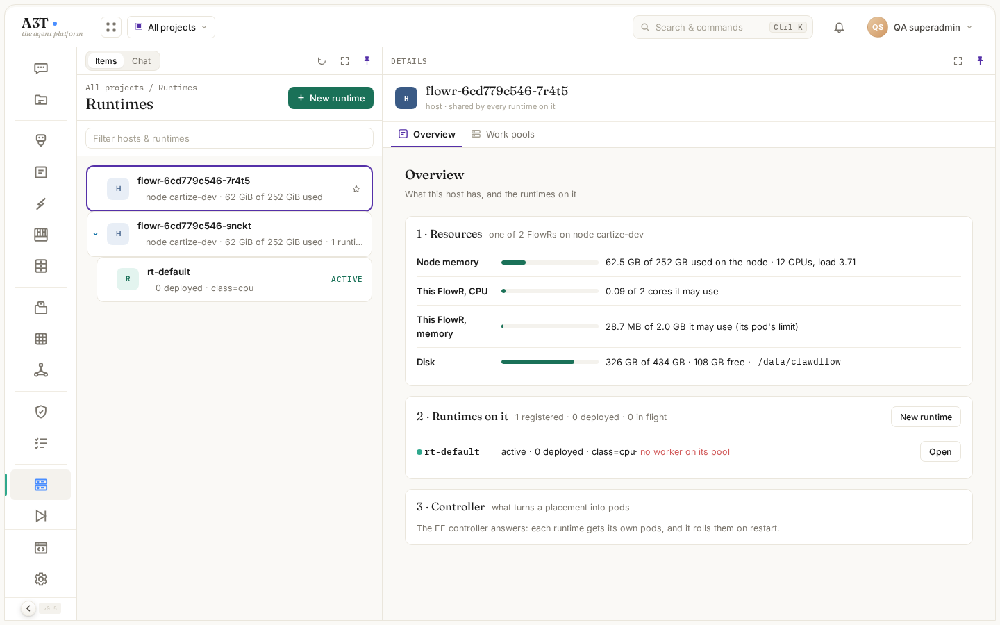

import { Aside } from '@astrojs/starlight/components';

**Open it:** [Runtimes](https://dash.a3t.io/runtime) · under **Runtimes & runs** in the console menu.

Runtimes shows what is running and where: each **FlowR** server (a host), the **runtimes** that take work, and the **deployments** on each, with their health and load.

Items is a tree: hosts, then runtimes, then what is deployed on each.

## Hosts

Each copy of FlowR reports itself every 20 seconds; Items lists every one seen in the last minute.

| On a host | What it means |
|---|---|
| **Node memory** | Memory used on the machine it runs on, with its CPUs and load |
| **This FlowR, CPU** and **memory** | What this copy of FlowR uses, out of what it may use (its pod's limits) |
| **Disk** | Its data disk |
| **Runtimes on it** | The runtimes, with how many deployments each has; **no worker on its pool** marks one that nothing is taking work for |
| **Controller** | Whether the EE controller answers: when it does, each deployed runtime gets its own pods |

**Work pools** lists the queues runs wait in until a worker claims them, with whether a worker is live and how many runs are queued.

## Runtimes

A runtime is a place deployed work runs: by default the shared runtime `rt-default`, or one made for a project, an organisation or a single agent. A runtime carries **labels** (such as `class=cpu`, `tier=prod`, `a3t.io/org=acme`) that canvases select it by; see [Canvas](../canvas/#placement).

| Control | What it does | Who |
|---|---|---|
| **Pause** | It takes no new work; callers get its paused response | A project's writers for its own runtime; an organisation's admins for theirs; SuperAdmin for shared ones |
| **Resume** | It takes work again | As above |
| **Hibernate** | Stops its pods until work arrives | As above |
| **Terminate** | Removes it. First shows what is deployed there and where each moves; confirm with its name | As above |

**New runtime** registers one: a name, a project, its labels.

## Deployments

Each deployment on a runtime shows whether it is serving, its runs and failures. Its controls: **Pause** (with a reason, shown to callers), **Resume**, **Restart**, **Undeploy**.

<Aside type="note">
Production placement, and pausing or stopping production, need the Admin role, as a person. An agent acting for an Admin is asked to confirm instead.
</Aside>
