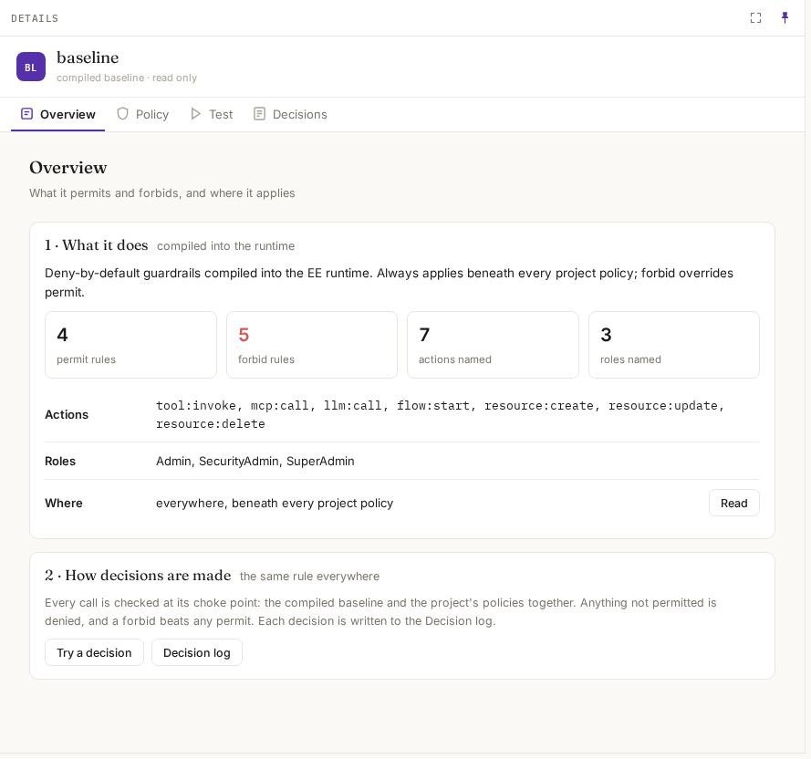
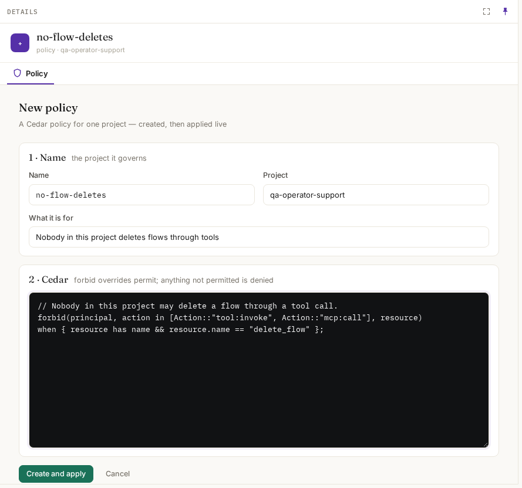
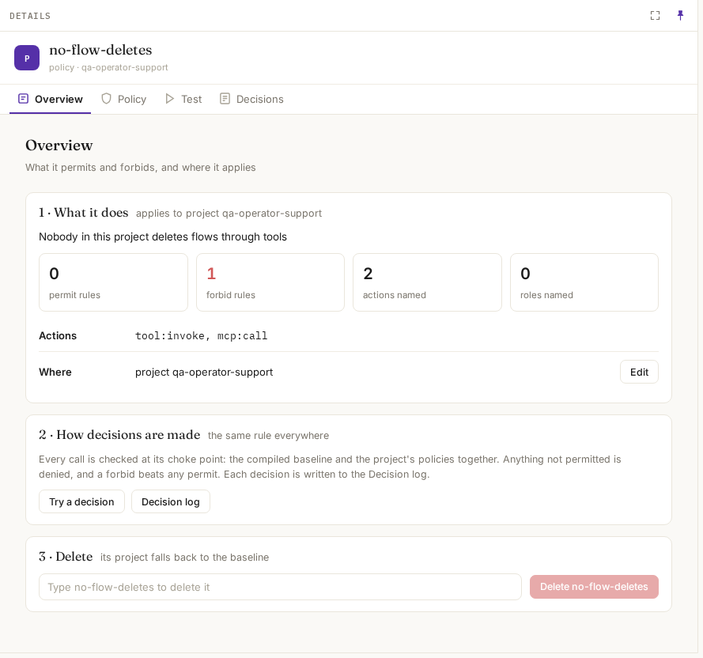
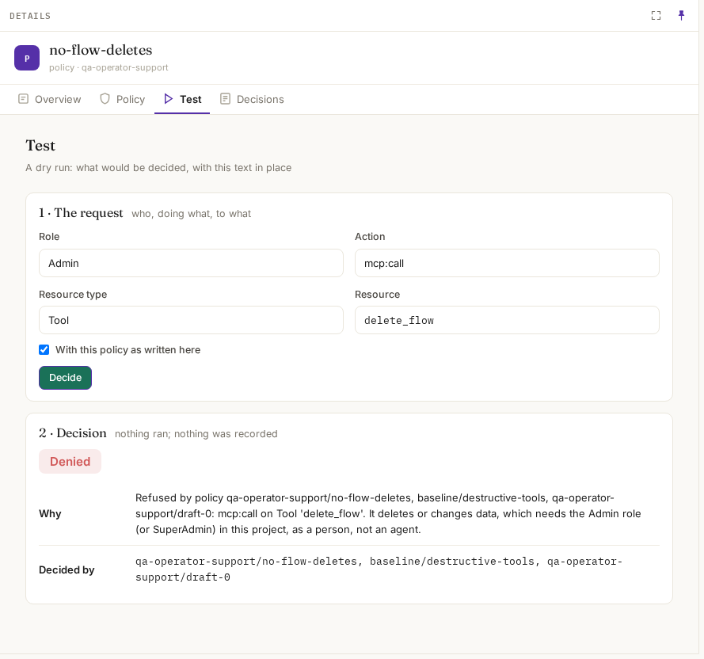
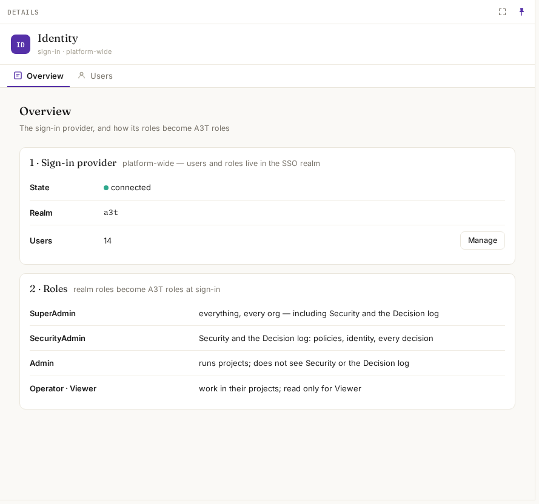

import { Aside } from '@astrojs/starlight/components';

**Open it:** [Security](https://dash.a3t.io/security) · under **Security & audit** in the console menu. For **SuperAdmin** and **SecurityAdmin** only; anyone else sees a note saying so.

Every call A3T makes on someone's behalf (a tool, a model, a flow start, a deploy, a change to a resource) is checked at its **choke point** against **Cedar** policies, as the person it is for, with their role in the project the call touches. Anything not permitted is denied, and a `forbid` beats any `permit`. Security is where those policies are written, tested and read.

Items lists:

| Item | What it is |
|---|---|
| **Identity** | The sign-in provider and its users, platform-wide |
| A policy per project | `<project>/<name>`: rules that apply to that project's calls only |
| **baseline** | The deny-by-default rules compiled into A3T, read from the server you are connected to (with its version). Read only; they apply everywhere, beneath every project policy |

## How a decision is made

1. The call's **principal** is the person (or the agent acting for one), with their **role in the project** the call touches: write access makes them Admin there, run access Operator, read access Viewer. SuperAdmin and SecurityAdmin keep their platform roles.
2. The **baseline** and the **project's own policies** are evaluated together. Platform policies (in `a3t`, `system` or `default`) apply to every project.
3. Nothing permits it, or a `forbid` matches: **denied**. The refusal names every policy that refused it, and, for a baseline rule, what access it needs.
4. The decision is written to the [Decision log](../decision-log/), with the version of the policy set that made it.

A refusal reads, for example:

```text
Refused by policy qa-operator-support/no-flow-deletes: mcp:call on Tool 'delete_flow'.
```

## The baseline



Each baseline rule has a name, `baseline/<rule>`, used in refusals and the log. The main ones:

| Rule | What it says |
|---|---|
| `baseline/humans-run-steps` | People may invoke tools, call MCP tools and models, and start flows |
| `baseline/agents-run-for-a-user` | Agents may too, but only when acting for a person |
| `baseline/destructive-tools` | Tools that delete or change data need the Admin role (or SuperAdmin) in the project, as a person, not an agent |
| `baseline/data-writes` | Writing or deleting data through a database step needs Admin, as a person |
| `baseline/flow-exposed-tools`, `baseline/flow-enabled-tools` | A flow may only use the tools it declares |
| `baseline/policies-are-infosecs` | Only SecurityAdmin and SuperAdmin may write Cedar policies |
| `baseline/authoring-needs-admin` | Creating flows, agents or templates through tools needs Admin in the project |
| `baseline/prod-deploy-needs-admin`, `baseline/isolated-deploy-needs-admin` | Production and isolated placement need Admin, as a person |
| `baseline/prod-operate-needs-admin` | Pausing or stopping production needs Admin |

**Policy** shows its full Cedar text.

## A project's policy

Pick a project in the top bar, then **New policy**.



| Field | What it means | Example |
|---|---|---|
| **Name** | What it does | `no-flow-deletes` |
| **Project** | The project whose calls it governs. A policy in `a3t`, `system` or `default` governs every project | `qa-operator-support` |
| **What it is for** | One sentence, shown on its Overview | `Nobody in this project deletes flows through tools` |
| **Cedar** | The rules: `permit` and `forbid` statements | below |

```text
// Nobody in this project may delete a flow through a tool call.
forbid(principal, action in [Action::"tool:invoke", Action::"mcp:call"], resource)
when { resource has name && resource.name == "delete_flow" };
```

**Create and apply** compiles it first: a policy that doesn't compile is refused with Cedar's error, and nothing changes. Once saved it applies at once, on every copy of FlowR.



| Tab | What it shows |
|---|---|
| **Overview** | What it does, counts of permit and forbid rules, the actions and roles it names, where it applies; **Delete** (its project falls back to the baseline) |
| **Policy** | Its Cedar text, to edit. **Save** compiles it before saving and applies it at once |
| **Test** | A dry run (below) |
| **Decisions** | Recent decisions that name it |

## Test: a dry run



| Field | What it means |
|---|---|
| **Role** | Who asks: SuperAdmin, SecurityAdmin, Admin, Operator or Viewer |
| **Action** | `mcp:call`, `tool:invoke`, `resource:create`, `resource:update`, `resource:delete`, `llm:call`, `flow:start`, `flow:deploy` |
| **Resource type** and **Resource** | What it is done to: a Tool, Resource, Llm, Flow or Runtime, by name, e.g. `delete_flow` |
| **With this policy as written here** | Test the text in the editor before saving it |

**Decide** shows **Allowed** or **Denied**, **Why**, and **Decided by**: every policy that decided it. Nothing runs and nothing is recorded. In the example, `delete_flow` is denied by `qa-operator-support/no-flow-deletes`, and `list_flows` is allowed by `baseline/humans-run-steps`.

An agent's own **Audit › Policies** has the same test, for that agent and its tools.

## Identity



| Section | What it shows |
|---|---|
| **Sign-in provider** | Its state, realm and number of users; **Manage** opens the provider. **Users** lists them |
| **Roles** | How the provider's realm roles become A3T roles at sign-in |

| A3T role | What it may do |
|---|---|
| **SuperAdmin** | Everything, in every organisation, including Security and the Decision log |
| **SecurityAdmin** | Security and the Decision log: policies, identity, every decision |
| **Admin** | Runs projects; does not see Security or the Decision log |
| **Operator** | Works in their projects |
| **Viewer** | Reads only, everywhere |

An organisation can sign its people in with its own identity provider; see [Settings](../settings/).

<Aside type="note">
**Act as.** A SuperAdmin can see the console exactly as a given user or role sees it: **Profile › Act as**. They give a reason, which goes in the [Decision log](../decision-log/); acting as another SuperAdmin is refused. The session is short, can't be extended, and every decision made during it records the SuperAdmin who acted.
</Aside>
