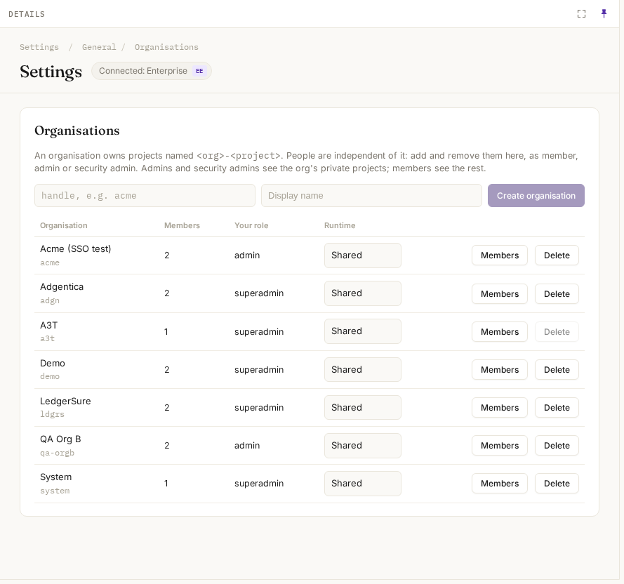

import { Aside } from '@astrojs/starlight/components';

**Open it:** [Settings](https://dash.a3t.io/settings) · last item in the console menu.

Settings holds the platform's setup, one section per item in Items. Sections marked **Enterprise** are part of A3T Enterprise Edition. Most are for SuperAdmins; organisation admins manage their own organisation here.

## Organisations

An **organisation** owns projects named `<org>-<project>`. People are independent of it: you add them to an organisation, as **member**, **admin** or **security admin**, and remove them, here.

| Organisation role | What they can do in its projects |
|---|---|
| **admin** | Change all of them, including private ones; manage the organisation's members |
| **security admin** | Read all of them, including private ones |
| **member** | Read the ones that aren't private; create projects in the organisation |

Each row shows its members, your role in it, and **Runtime**: **Shared** (its projects run on the platform's runtimes) or **Isolated** (only on runtimes labelled for it). **Create organisation** adds one (SuperAdmin). **Members** opens its people and its sign-in.

## An organisation's own sign-in (SSO)

An organisation's sign-in is managed under [Security](../security/) › *org* › Identity › **Sign-in** (**Members** here opens the same page). There its admins:

- **connect their own identity provider** (any OpenID Connect provider: Entra ID, Okta, Google, their own Keycloak) with its issuer, client id and secret, groups claim and email domains; A3T checks it and connects it, with no platform staff involved;
- say **which groups get which org role** in the policy file `access/org.yaml`;
- turn on **Provisioning (SCIM)**, so people deactivated in their provider lose the organisation at once.

On the sign-in page, people choose **Sign in with single sign-on** and enter their work email (or the organisation's name); A3T sends them to their organisation's provider and back. See [Identity and roles](../../governance/identity-and-roles/#your-orgs-own-identity-provider).

<Aside type="note">
Memberships made by sign-in are rewritten at every sign-in, from the person's groups. People added by hand on **Members** are not changed by sign-in. An organisation's people can still be given access to another organisation's projects, by that project's owner, by name.
</Aside>

## The other sections

| Section | What it sets |
|---|---|
| **Platform** | The platform's name |
| **Runtime**, **Clusters** | Where A3T runs work |
| **Appearance** | The console's look |
| **Storage & Data**, **Storage Backend**, **Platform Database** | Where A3T keeps its own data (Enterprise) |
| **ADB Embeddings** | The embedding model ADB uses to recall by meaning. A different model re-embeds every memory (Enterprise) |
| **ADB Memory Cache** | Which memory ADB keeps hot, per memory type (Enterprise) |
| **Logs & Retention**, **Image Registry**, **Notifications**, **Webhooks** | Operations |
| **Plan & Usage**, **Payment Methods**, **Invoices** | Billing (Enterprise) |
| **Feature Flags**, **Telemetry** | Developer settings |

Settings has no security or identity controls. Sign-in, people and roles are under [Security](../security/) › Identity, policies under [Security](../security/), the record of decisions in the [Decision log](../decision-log/), and agent keys on each agent's own page.

## Your profile

The menu under your name in the top bar has your **Profile**: your handle, your organisations and your roles. A SuperAdmin also has **Act as**: see the console exactly as a given person or role sees it. You say why first; the reason goes in the [Decision log](../decision-log/). You can't act as another SuperAdmin. Your own session ends when acting starts; the borrowed one is short and can't be extended, an amber **Acting as … Stop** pill shows it, and every decision made during it records the SuperAdmin who acted. **Stop** ends it, and you sign in again as yourself.

## Sessions

A sign-in lasts at most a week. Access tokens last an hour and renew on their own while the console is open; each renewal token works once, and if a copy is ever used again the whole session ends. **Sign out** ends the session on every server within seconds, not just in your browser.
