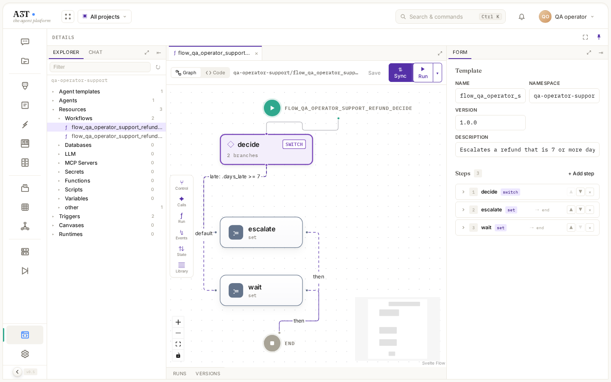
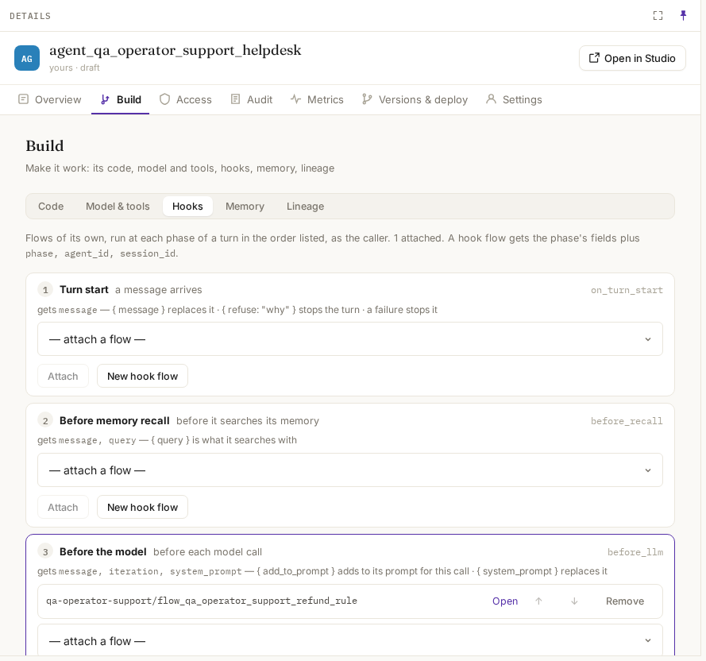

import { Aside } from '@astrojs/starlight/components';

**Open it:** [Studio](https://dash.a3t.io/studio) · under **Settings** in the console menu, or **Open in Studio** / **Edit in Studio** on any agent, template, trigger, canvas or resource.

Studio is where you write **flows**: a series of steps, in [CNCF Serverless Workflow](../../concepts/cncf-swf/) YAML. New to either? Read [How to read and write YAML](https://blog.a3t.io/how-to-read-and-write-yaml/) and [The CNCF Workflow DSL, explained](https://blog.a3t.io/cncf-workflow-dsl-explained/). A flow can run on its own, be started by a [trigger](../triggers/), be called by another flow, or run inside an agent's turn as a **hook**. Templates, triggers and canvases are edited here too.



| Area | What it is |
|---|---|
| **Explorer** | The project's agent templates, agents, resources (flows, databases, models, MCP servers, secrets…), triggers, canvases and runtimes. **New in …** starts one. **Chat** beside it talks to the A3T assistant about what is open |
| **Editor** | The open item, as a **Graph** or as **Code** (YAML). Both edit the same flow |
| **Palette** | Steps to add, by kind: **Control** (switch, for, fork, try), **Calls** (LLM, MCP, HTTP, ADB, agent), **Run** (another flow), **Events**, **State**, **Library** |
| **Form** | The flow's name, namespace, version and description, and its steps in order: add, move, remove |
| **Save** | Saves the flow as its version. **Sync** reloads it from the server |
| **Run** | Runs it; **Run with inputs** asks for its input first |
| **Runs**, **Versions** | Its recent runs, each opening in [Executions](../executions/); its versions |

## Write a flow

The example decides what to do about a late refund: escalate one that is 7 or more days late, otherwise ask the customer to wait.

```yaml
document:
  dsl: 1.0.3
  namespace: qa-operator-support          # the project it belongs to
  name: flow_qa_operator_support_refund_decide
  version: 1.0.0
  title: Decide what to do about a late refund
input:
  schema:                                  # what it must be started with
    format: json
    document:
      type: object
      required: [order_id, days_late]
      properties:
        order_id: { type: string }
        days_late: { type: integer }
do:
  - decide:
      switch:
        - late:
            when: ${ .days_late >= 7 }
            then: escalate
        - default:
            then: wait
  - escalate:
      set:
        order_id: ${ .order_id }
        action: escalate
        note: ${ "Order " + .order_id + " is " + (.days_late | tostring) + " days late; hand it to a person." }
      then: end
  - wait:
      set:
        order_id: ${ .order_id }
        action: wait
        note: ${ "Order " + .order_id + " is within the normal window; ask the customer to wait." }
      then: end
```

**Run with inputs** `{"order_id": "A-1042", "days_late": 10}` gives:

```json
{ "order_id": "A-1042", "action": "escalate", "note": "Order A-1042 is 10 days late; hand it to a person." }
```

and `{"order_id": "A-1042", "days_late": 3}` gives `"action": "wait"`.

| Rule | Why |
|---|---|
| Name it `flow_<project>_<what it does>` | So it is found and understood anywhere it is used |
| Declare its [**input schema**](https://blog.a3t.io/cncf-workflow-dsl-explained/#swf-input) | Callers, and **Run with inputs**, see what it needs |
| A released version never changes | Saving the same version with other content is refused (`version_exists`); give it the next version. Runs and agents can stay on the version they use |
| Every step is checked as it runs | A call is a policy decision, as the person the run is for; see [Security](../security/) |

## Policy files

Each project in the Explorer has **Policies**, with the org's files that apply there: **Rules** (`policies/`), **Roles** (`roles/`), **Access** (`access/`) and **Calls out** (`egress/`). Labels show a file that is **(off)** or **(broken)**. A file that names no project you can see, or doesn't parse, is listed under ***org* · Unplaced policy files**, so nothing in force is hidden. **+** on a folder starts a new file from a starter.

Open a file and the panel on the right **checks** it: the org's enforced files are compiled with your text in place, again a moment after each edit, and nothing is saved. **Replay** runs your draft against the org's recent decisions and says how many would change. Saving checks it the same way and, with the org's second approver on, waits for another admin. Switch files on, off or to shadow under [Security](../security/) › *org* › Policy files. See [Policy files](../../governance/policy-files/).

## Hook a flow into an agent

A **hook** is a flow of yours that runs at a fixed point in every turn of an agent, as the caller. Attach hooks on the agent's **Build › Hooks**: pick a flow for a phase and click **Attach** (or **New hook flow** to start one from a ready-made skeleton), then **Save**. Several hooks on one phase run in the order listed; **↑** and **↓** reorder them.



| Phase | Runs | Gets | What it can return |
|---|---|---|---|
| `on_turn_start` | When a message arrives | `message` | `{ message }` replaces it; `{ refuse: "why" }` stops the turn |
| `before_recall` | Before it searches its memory | `message`, `query` | `{ query }`: what it searches with |
| `before_llm` | Before each model call | `message`, `iteration`, `system_prompt` | `{ add_to_prompt }` adds to the prompt for this call; `{ system_prompt }` replaces it |
| `after_llm` | After each model call | `iteration`, `content`, `tool_calls` | Observes only: the text has already streamed |
| `on_tool_call` | Before each tool call | `tool`, `input` | `{ input }` replaces the arguments; `{ refuse: "why" }` blocks it, and the model is told |
| `after_tool_call` | After each tool call | `tool`, `input`, `output` | `{ output }`: what the model sees, e.g. redacted |
| `on_tool_error` | A tool call failed | `tool`, `input`, `error` | `{ output }` is used in place of the error |
| `before_store` | Before the turn is remembered | `message`, `reply` | `{ reply }`: what is remembered; `{ skip: true }` remembers nothing |
| `on_turn_end` | The caller has its answer | `message`, `reply`, `tool_calls`, `iterations`, `outcome` | Observes only: log, notify, check |

A hook that fails at `on_turn_start` stops the turn; one that fails at `on_tool_call` blocks that call.

### Example: a refund rule before every model call

```yaml
document:
  dsl: 1.0.3
  namespace: qa-operator-support
  name: flow_qa_operator_support_refund_rule
  version: 1.0.0
  title: Refund rule for the help-desk agent
do:
  - add_rule:
      set:
        add_to_prompt: Refunds not received 7 or more days after approval are escalated to a person; never promise a date.
```

Attached to the help-desk agent at `before_llm`, it changes its answers at once. Asked *"Order B-2210: my refund was approved 10 days ago and still has not arrived. When will I get it?"*, the agent answered:

> Since it's been 10 days since approval — which is past the 7-day threshold — this needs to be escalated to a person on our team who can investigate and resolve it directly. I can't promise a specific date, but let me hand this over now…

<Aside type="tip">
Put a rule that every agent of a kind needs in a **template**, so its agents get it from their code; put one that only this agent needs in a hook. See [Templates](../templates/).
</Aside>
