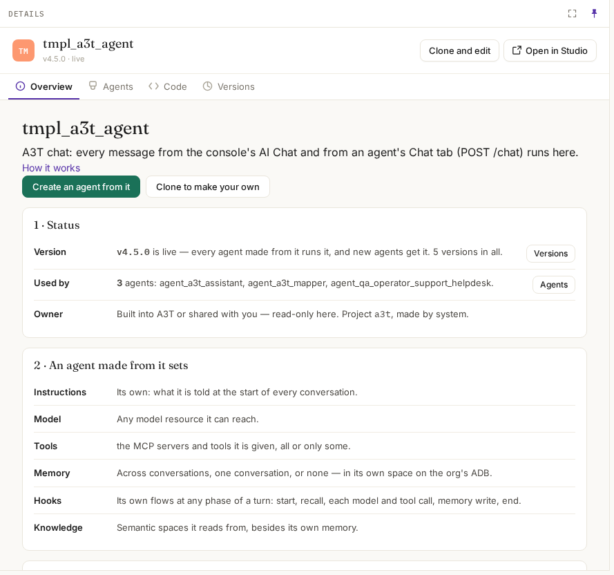
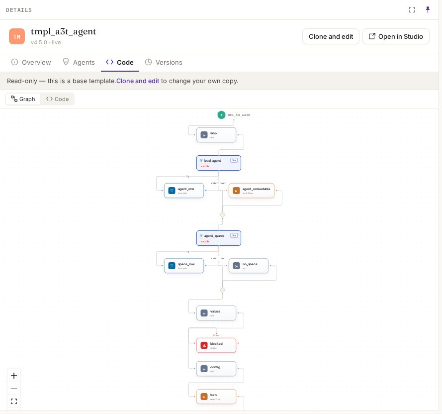
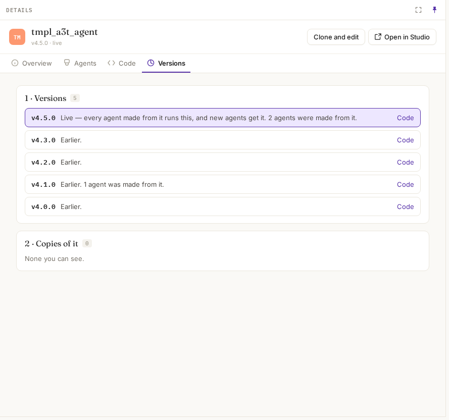
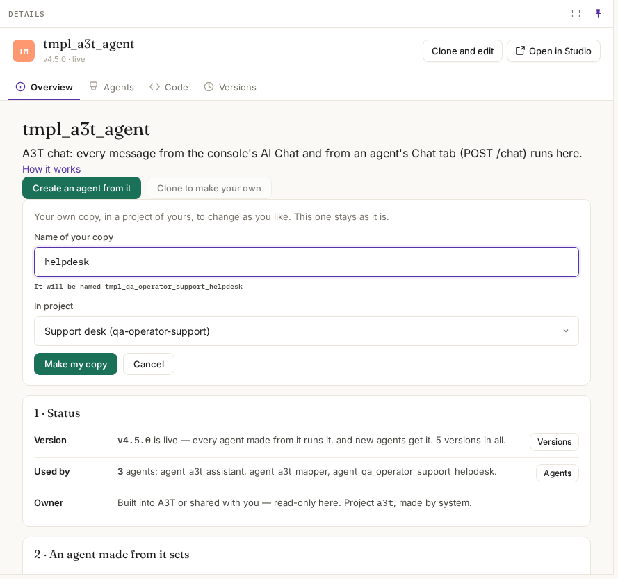
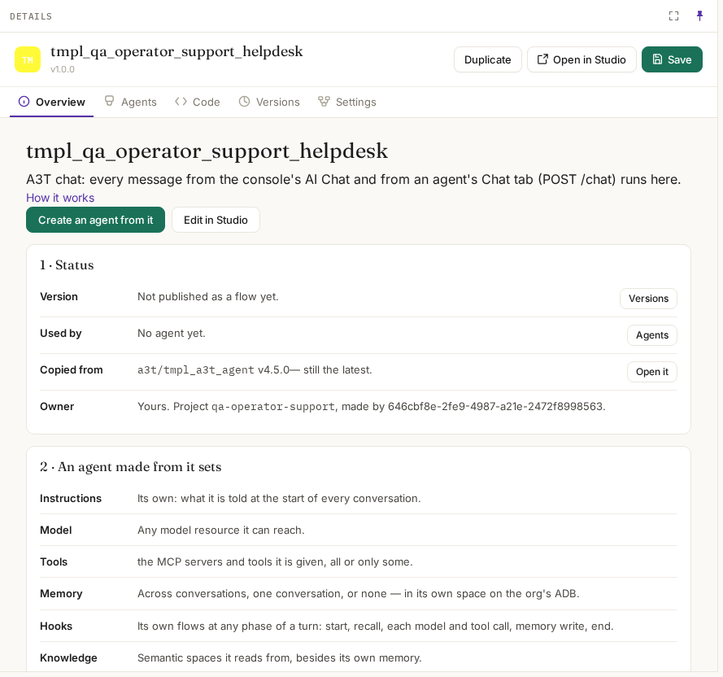

import { Aside } from '@astrojs/starlight/components';

**Open it:** [Templates](https://dash.a3t.io/templates) · under **Agents** in the console menu.

A **template** is the code of an agent: a flow, in [CNCF Serverless Workflow](https://blog.a3t.io/cncf-workflow-dsl-explained/) YAML, that says how each message is handled. An **agent** is a template plus its own settings. Think of the template as the code and the agent as the product: many agents can run one template, each with its own instructions, model, tools and memory.

## Base templates

A3T comes with three. They are read-only; copy one to change it.

| Template | Project | What it is for |
|---|---|---|
| `tmpl_a3t_agent` | a3t | The chat agent: reads its memory, calls its model, uses its tools, remembers the turn. Most agents use it |
| `tmpl_a3t_service` | a3t | A3T's own service agents, each serving a set of A3T's flows as tools |
| `tmpl_system_agent_engine` | system | The core agent every template above runs on. Not for direct use |

## A template's tabs

| Tab | What it shows |
|---|---|
| **Overview** | What it is for; **Status** (live version, how many agents use it, where it was copied from, owner); **An agent made from it sets** (what each agent decides for itself); **What it runs and reaches**. **Create an agent from it** starts the New agent form with this template chosen |
| **Agents** | The agents built from it, with their project and status |
| **Code** | Its flow, as a graph and as YAML. Base templates are read-only here |
| **Versions** | Every version; the **live** one is what its agents run and what new agents get. Also the copies made of it |
| **Settings** | Your own templates only: name, description, delete |

### What an agent made from it sets for itself

| Setting | What each agent chooses |
|---|---|
| **Instructions** | Its own: what it is told at the start of every conversation |
| **Model** | Any model resource it can reach |
| **Tools** | The MCP servers and tools it is given, all or only some |
| **Memory** | Across conversations, one conversation, or none, in its own memory space |
| **Hooks** | Its own flows at any phase of a turn |
| **Knowledge** | Semantic spaces it reads from, besides its own memory |

## Versions

A version is fixed once released: a change is the next version. The **live** version is what every agent made from it runs, and what new agents get. Agents made from an earlier version are listed against it.

## Make your own

On a base template, click **Clone to make your own** (or **Clone and edit** in the header).

| Field | What it means | What to put |
|---|---|---|
| **Name of your copy** | What it does. A3T names it `tmpl_<project>_<name>` and shows the full name under the field | Lowercase letters, digits, dashes or underscores, e.g. `helpdesk` |
| **Project** | Where the copy goes. Only projects where you can author are listed | Your project |

**Make my copy** creates it and opens it:

| On the copy | Meaning |
|---|---|
| **Version: Not published as a flow yet** | The copy's code is saved as a flow the first time you save it in **Studio**. Until then it has no version of its own |
| **Copied from** | The template and version it came from, and whether that is still the latest |
| **Owner** | Your project, and who made it |

Open **Edit in Studio** to change its code; see [Studio](../studio/). **New template** in Items starts one from an empty agent flow instead, with its name made the same way.

<Aside type="note">
Agents made from a template are **served by** the flow named in it. A copy keeps the original's serving flow (`a3t/tmpl_a3t_agent`) until you change its code, so an agent made from a fresh copy behaves like one made from the original.
</Aside>

## Naming

| What | Name | Example |
|---|---|---|
| A template | `tmpl_<project>_<what it does>` | `tmpl_qa_operator_support_helpdesk` |
| An agent | `agent_<project>_<what it does>` | `agent_qa_operator_support_helpdesk` |
| A flow | `flow_<project>_<what it does>` | `flow_acme_support_refund` |

`<project>` is the project's namespace with dashes made underscores.

## Deleting

A template can't be deleted while agents are built from it: the refusal names them. Delete or move those agents first. Base templates can't be deleted.

## Example

Acme's support team wants every help-desk agent to redact card numbers before the model sees them:

1. On `tmpl_a3t_agent`, **Clone to make your own** into `acme-support`, named `helpdesk`: it becomes `tmpl_acme_support_helpdesk`.
2. **Edit in Studio**: add a `before_llm` hook step that redacts card numbers, and save. The template now has its first version.
3. Make the team's agents from it with **Create an agent from it**. Each keeps its own instructions and keys; all of them redact.
4. Later changes to the template are new versions. Its agents run the live one.
