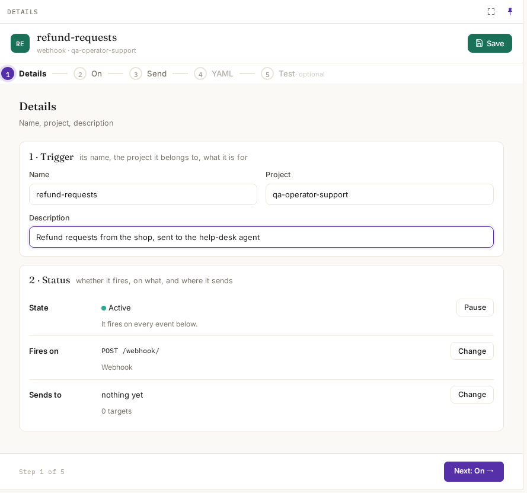
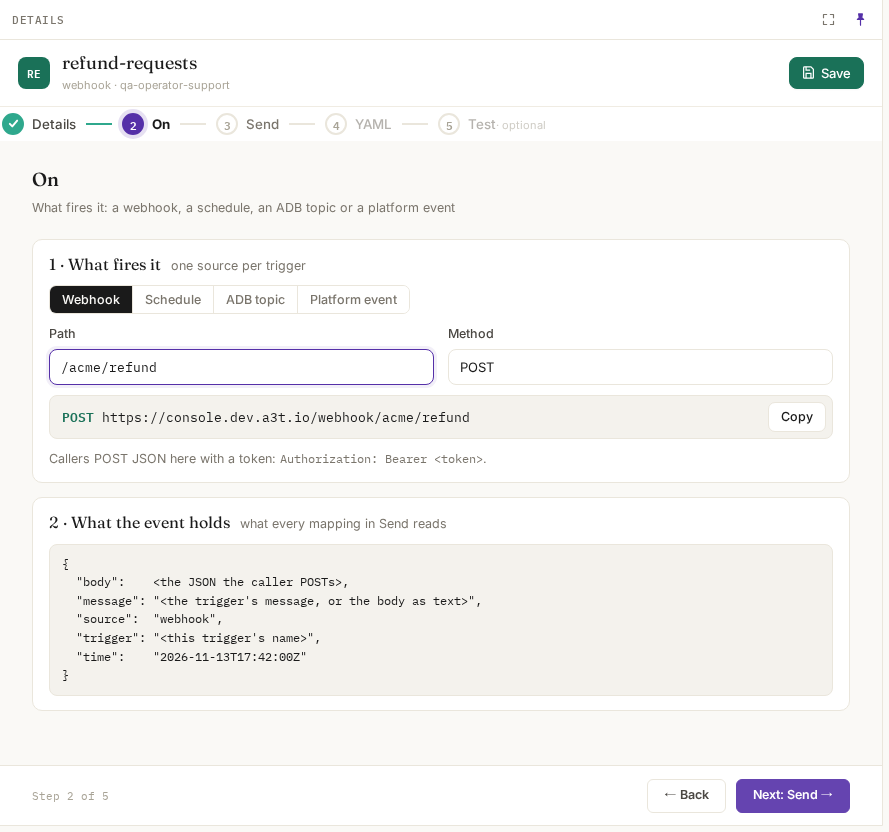
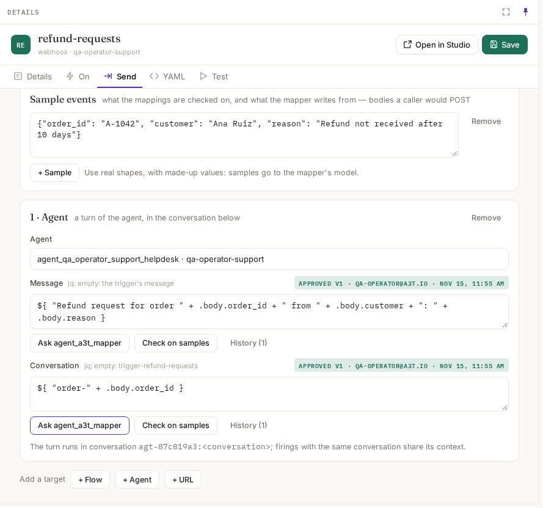
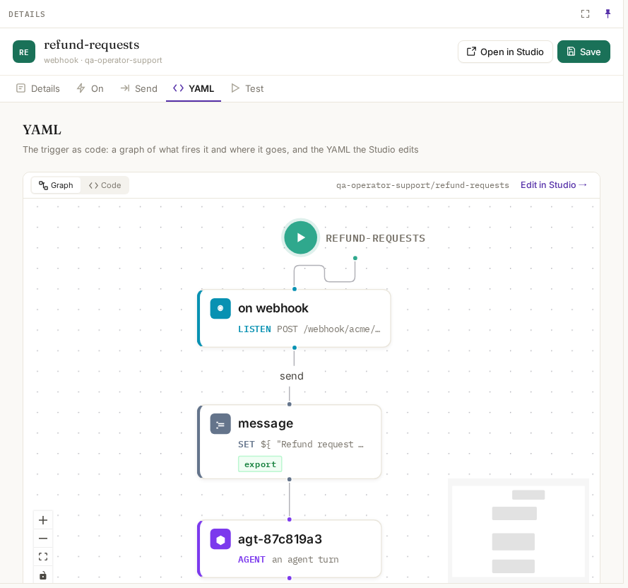
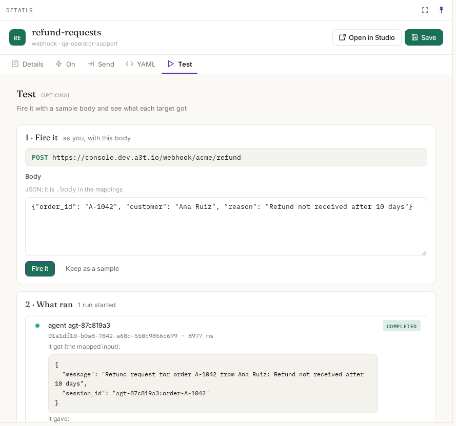

import { Aside } from '@astrojs/starlight/components';

**Open it:** [Triggers](https://dash.a3t.io/triggers) · under **Agents** in the console menu.

A **trigger** starts something on its own. It listens on **one source** (a web address, a schedule, an ADB topic or a platform event) and, each time it fires, **sends** to one or more targets: a flow, an agent, or a URL. What each target gets is a **mapping**, written in jq, checked on sample events and approved before it is used.

New trigger opens a five-step form: **Details**, **On**, **Send**, **YAML**, **Test**. The example below sends refund requests from a shop to the help-desk agent from the [Quick start](../../getting-started/quickstart/).

## 1. Details



| Field | What it means | Example |
|---|---|---|
| **Name** | What it is, in a few words. Used in the conversation name when no mapping gives one | `refund-requests` |
| **Project** | The project it belongs to. Its members can see and change it, by their roles | `qa-operator-support` |
| **Description** | What it is for | `Refund requests from the shop, sent to the help-desk agent` |
| **State** | **Active**: it fires. **Pause**: it doesn't, until you resume it | Active |

## 2. On: what fires it



| Source | Fields | When it fires |
|---|---|---|
| **Webhook** | **Path** (e.g. `/acme/refund`) | When a caller POSTs JSON to `https://<your A3T address>/webhook<path>`. A token (`Authorization: Bearer <token>`) is optional: with one, the runs act as that person; without one, as the trigger service. A path with no trigger answers 404 |
| **Schedule** | A cron expression (e.g. `*/5 * * * *`, every five minutes), a time zone (e.g. `UTC`) and an optional message, which becomes the event's `message` | On every tick. Each tick runs each target once, even with several copies of FlowR |
| **ADB topic** | The ADB resource (e.g. `a3t/adb`) and the topic (e.g. `orders`) | For each message published to the topic |
| **Platform event** | The event type (e.g. `system.workflow.completed`) | When A3T emits that event |

Every source makes the same **event**, and that is what the mappings read:

```json
{
  "body":    <the JSON the caller POSTs, the tick, the topic message, or the event>,
  "message": "<the trigger's message, or the body as text>",
  "source":  "webhook",
  "trigger": "<this trigger's name>",
  "time":    "2026-11-15T11:55:00Z"
}
```

## 3. Send: targets and mappings



**Sample events** come first: bodies a caller would send, with made-up values. Mappings are checked on them, and the mapper agent writes from them, so use real shapes. Then add targets:

| Target | What it runs | Its mappings |
|---|---|---|
| **+ Agent** | A turn of the agent | **Message**: what the agent is told (empty: the trigger's message). **Conversation**: which conversation the turn is in (empty: `trigger-<name>`). Firings with the same conversation continue it |
| **+ Flow** | A run of the flow | **Input**: the flow's input, shaped to its input schema |
| **+ URL** | Posts the event on to another service, at the **URL** you give | None: the event is sent as it is |

A mapping is a jq expression over the event, wrapped as `${ … }`. You can write it, or click **Ask agent_a3t_mapper** to have A3T's mapping agent propose one from your samples and the target. Either way:

1. **Check on samples** runs it on every sample, exactly as a firing would, and shows the result.
2. **Approve this mapping** records it as an approved version, with who approved it and when. **History** lists earlier versions.
3. When the trigger fires, **only the approved jq runs**. A hand-written or proposed mapping that isn't approved is never used.

The example's mappings:

| Mapping | jq | On the sample, gives |
|---|---|---|
| Message | `${ "Refund request for order " + .body.order_id + " from " + .body.customer + ": " + .body.reason }` | `Refund request for order A-1042 from Ana Ruiz: Refund not received after 10 days` |
| Conversation | `${ "order-" + .body.order_id }` | `order-A-1042` |

## 4. YAML



The trigger as code. **Graph** draws what fires it and where it goes; **Code** is the YAML Studio edits:

```yaml
name: refund-requests
project: qa-operator-support
description: Refund requests from the shop, sent to the help-desk agent
enabled: true
on:
  webhook:
    path: /acme/refund
    method: POST
send:
  - agent: agt-87c819a3
    message: '${ "Refund request for order " + .body.order_id + " from " + .body.customer + ": " + .body.reason }'
    conversation: ${ "order-" + .body.order_id }
```

## 5. Test



**Fire it** sends the body to the trigger as you, exactly as a caller would, and follows each run it starts:

- **It got (the mapped input)**: what the target received after the mappings ran.
- **It gave**: the target's output.
- The run's id and time: open it in [Executions](https://dash.a3t.io/executions) for every step.

**Keep as a sample** adds the body to the samples. The example's test:

```json
// It got (the mapped input):
{
  "message": "Refund request for order A-1042 from Ana Ruiz: Refund not received after 10 days",
  "session_id": "agt-87c819a3:order-A-1042"
}
```

A run started by a trigger shows **Started by Trigger refund-requests** in Executions, with a link back to it.

## Calling a webhook trigger

```bash
curl -X POST "$A3T_URL/webhook/acme/refund" \
  -H "Authorization: Bearer $TOKEN" \
  -H "Content-Type: application/json" \
  -d '{"order_id": "A-1042", "customer": "Ana Ruiz", "reason": "Refund not received after 10 days"}'
```

The answer says which targets it reached and the runs it started; a mapping that failed or a target that refused is named with the reason.

<Aside type="note">
Removing a trigger stops it at once: its schedule stops, and its web address answers 404.
</Aside>
