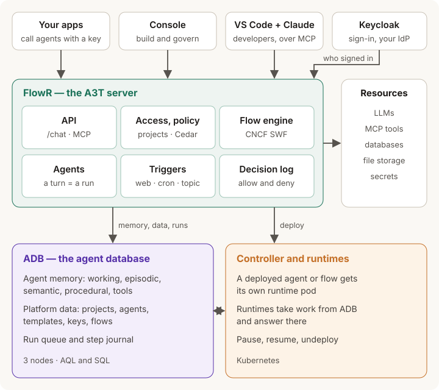
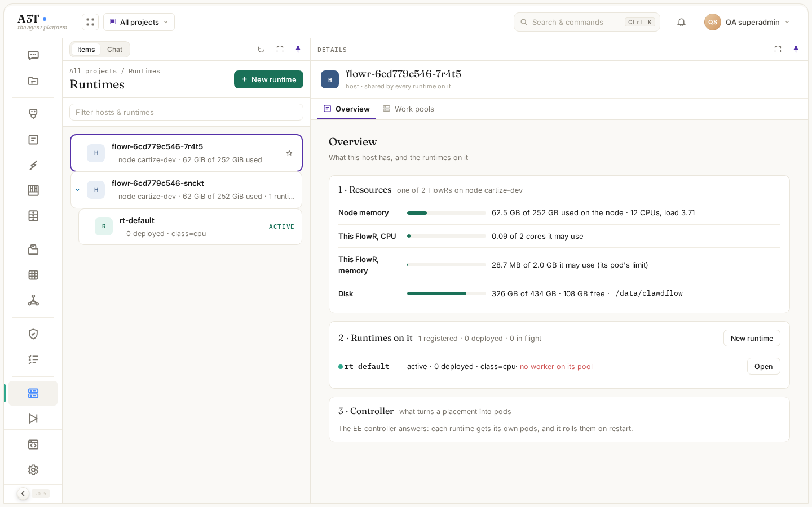

import { Aside } from '@astrojs/starlight/components';

A3T has four parts: **FlowR**, the server that runs agents and flows; **ADB**, the database that holds their memory and A3T's own data; **Keycloak**, which signs people in; and the **controller**, which gives a deployed agent its own place to run. You reach all of them through FlowR's API, from your apps, the console or your editor.



## The parts

| Part | What it is | What it does for you |
|---|---|---|
| **Console** | The web app at `https://dash.a3t.io` | Build agents, templates, triggers and policies; read memory, runs and decisions |
| **FlowR** | The A3T server, written in Rust. You can run as many copies as you need | Serves the API, checks access, runs flows and agents, fires triggers, logs every decision |
| **ADB** | The agent database, a cluster of three nodes | Keeps each agent's memory, A3T's data (projects, agents, templates, keys, flows) and the queue of runs |
| **Keycloak** | The sign-in service | Signs people in, with A3T accounts or your organisation's own identity provider (SSO) |
| **Controller and runtimes** | A Kubernetes controller and the pods it starts | Gives each deployed agent or flow its own runtime, and pauses, resumes or removes it |
| **Resources** | The outside services you connect | Models (Anthropic, OpenAI, Ollama…), MCP tool servers, databases, file storage and secrets |

FlowR keeps nothing of its own. Everything it needs is in ADB, so any copy of FlowR can answer any request, and a copy can restart without losing work.

## What things are made of

Everything you build in A3T is a small set of objects, and every object belongs to a **project**.

| Object | What it is | Where you see it |
|---|---|---|
| Project | A folder with members and roles. Personal (yours) or an organisation's | [Projects](https://dash.a3t.io/projects) |
| Template | The code of an agent: a flow in CNCF Serverless Workflow YAML | [Templates](https://dash.a3t.io/templates) |
| Agent | A template plus its settings: model, instructions, tools, memory, keys | [Agents](https://dash.a3t.io/agents) |
| Flow | A series of steps, in the same YAML. An agent can call a flow as a tool | [Studio](https://dash.a3t.io/studio) |
| Trigger | What starts an agent or flow on its own: a web address, a schedule, an event | [Triggers](https://dash.a3t.io/triggers) |
| Canvas | Where and how an agent or flow runs when it is deployed | [Canvas](https://dash.a3t.io/canvas) |
| Resource | A connection to an outside service, set up once and used by name | [Resources](https://dash.a3t.io/resources) |
| Policy | A Cedar rule on what may happen in a project | [Security](https://dash.a3t.io/security) |

## One request, step by step

Here is what happens when an app sends one message to an agent:

```bash
curl -N "$A3T_URL/chat" \
  -H "Authorization: Bearer $AGENT_KEY" \
  -H "Content-Type: application/json" \
  -d '{"session_id": "agt-1a2b3c4d:ticket-4182", "message": "Where is my refund?"}'
```

1. **FlowR checks who is calling.** An agent key (`a3tk_…`) reaches only its own agent, and only if that agent still exists. A person's sign-in token comes from Keycloak.
2. **FlowR checks the project.** The agent belongs to a project, and the caller needs at least run access to it.
3. **FlowR queues the turn.** Each turn is a run of the agent's template flow. The run goes into the queue in ADB, and a FlowR worker picks it up.
4. **The agent loads what it knows.** It reads its settings, then recalls from its memory in ADB: this conversation's earlier turns, facts and procedures that match the message, and any shared knowledge attached to it.
5. **It calls the model.** Before the call, Cedar checks `llm:call` on the model, as the user the agent acts for. The model's answer streams back to the app as it is written.
6. **It uses tools.** Each tool the model asks for is checked (`tool:invoke` or `mcp:call`) before it runs. A refused call is answered with the reason and the policy that refused it.
7. **It remembers.** The turn is stored in the agent's episodic memory, so the next message in `ticket-4182` starts from here.
8. **Everything is recorded.** The run, each step's input and output, and each allow or deny decision can be read afterwards in [Executions](https://dash.a3t.io/executions) and the [Decision log](https://dash.a3t.io/logs).

<Aside type="note">
Steps 3 to 7 run the same way when a trigger starts the agent, or when a person tries it in the console. Only step 1 differs: a trigger acts as the trigger, and a person as themselves.
</Aside>

## Where it runs

By default, agents and flows run inside FlowR itself. When you **deploy** one from its canvas, the controller gives it its own runtime pod. That pod takes work for it from ADB and answers there, so it can be paused, restarted or moved without touching anything else.



[Runtimes](https://dash.a3t.io/runtime) shows each copy of FlowR, the node it is on and its memory, and the runtimes with what is deployed on each.

## Next

The [Quick start](../quickstart/) walks through making a project and an agent, field by field, and calling it from an app.
