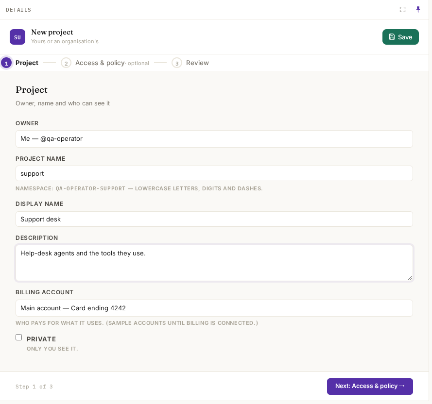
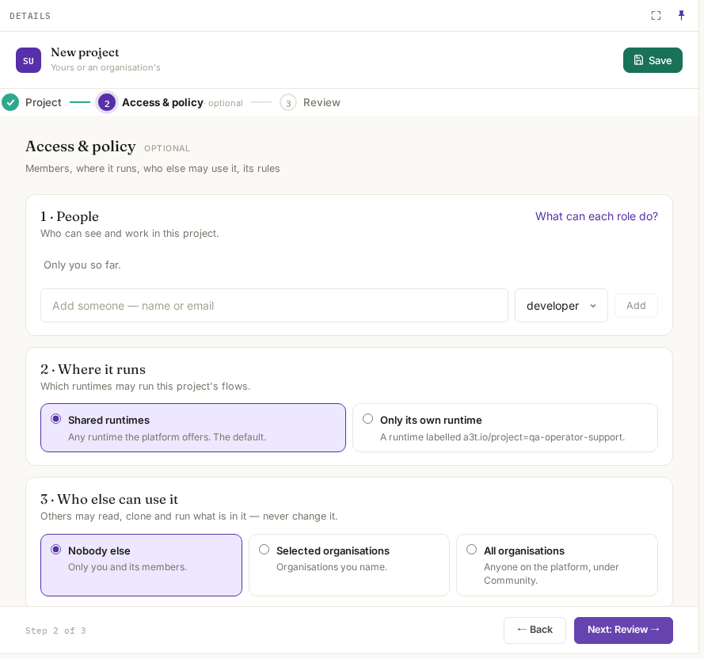
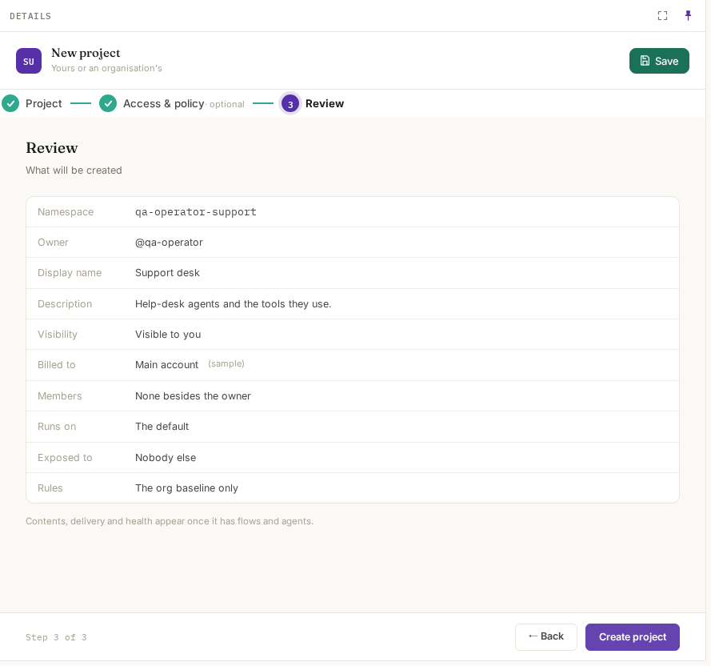
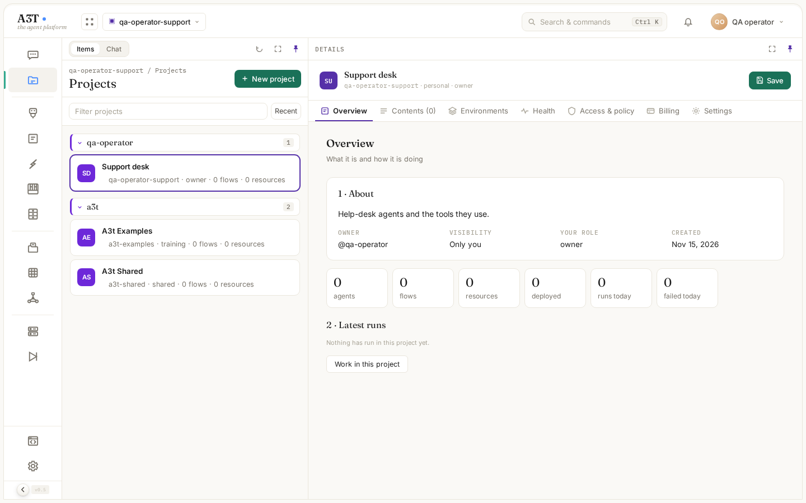
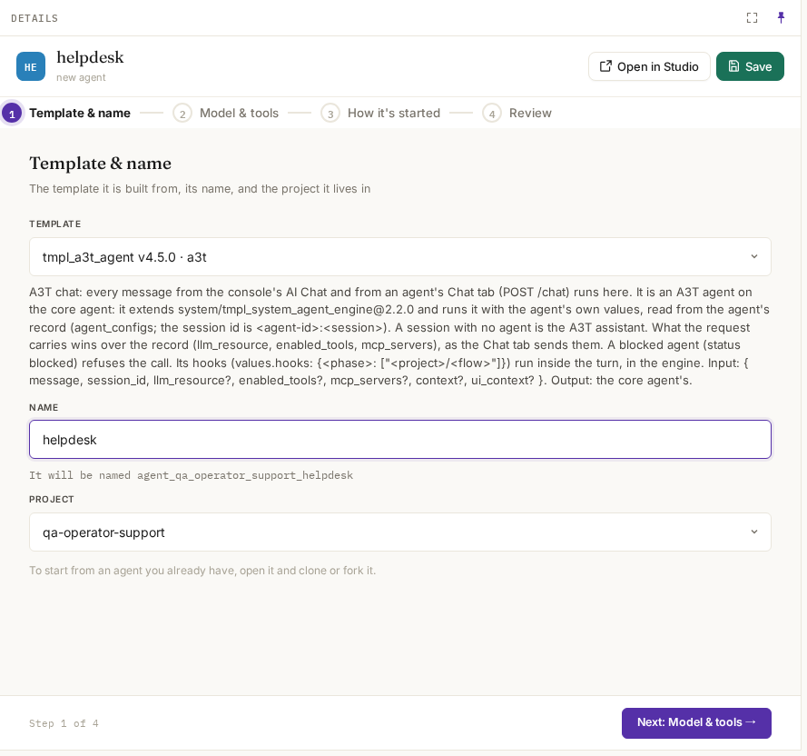
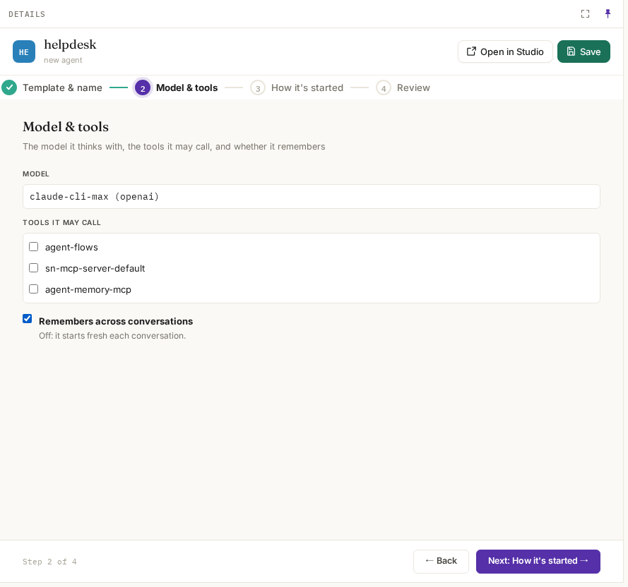
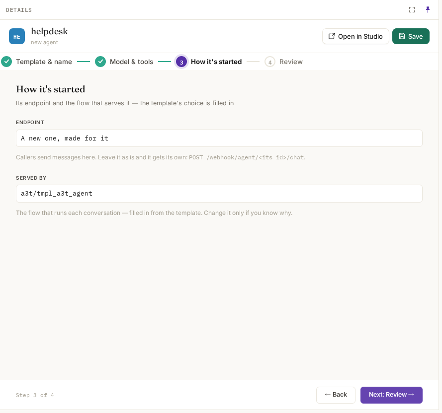
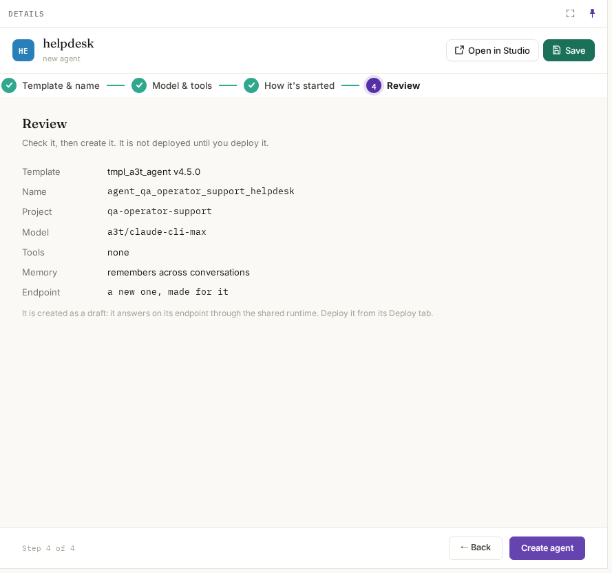
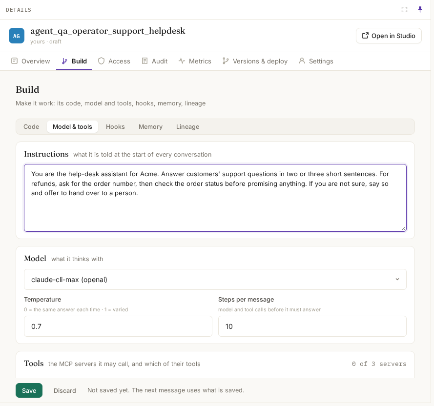
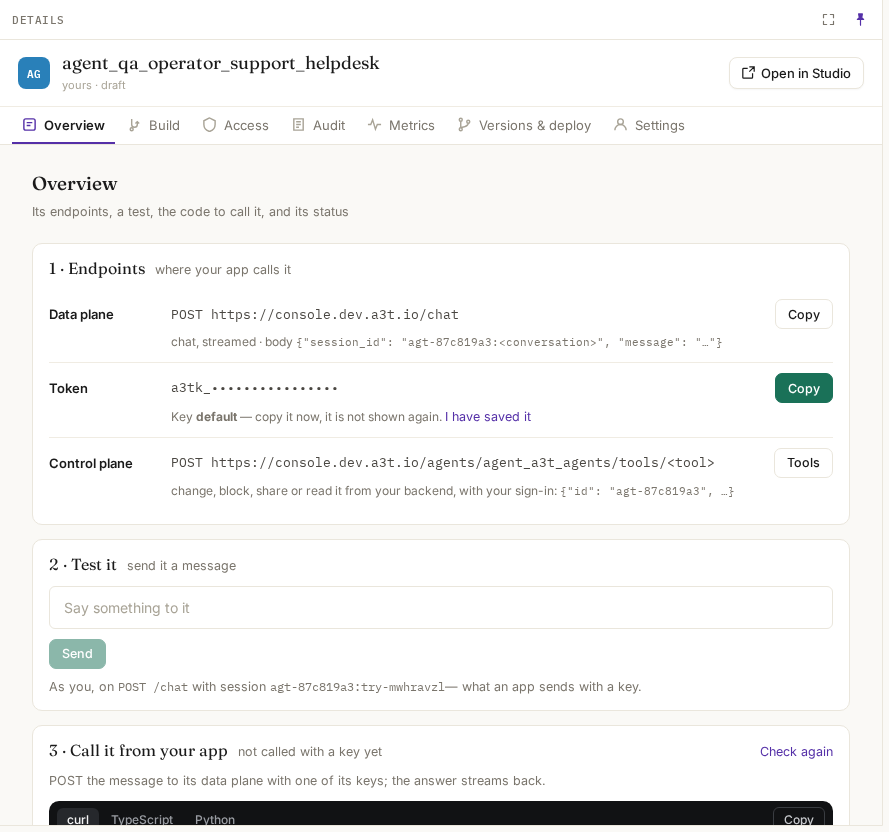

import { Aside, Steps } from '@astrojs/starlight/components';

In about ten minutes you will have a help-desk agent your app can call. You make a **project** to hold it, an **agent** in that project, give it **instructions** and a **key**, and call it with one HTTP request. Every field on the way is explained below: what it is for, what to put in it and what happens if you leave it.

The example uses a person whose handle is `qa-operator`. Yours will be your own handle.

**You need:** an A3T account with the **Operator** role or higher, signed in at [dash.a3t.io](https://dash.a3t.io). No account yet? See [Get access and sign in](../../console/access/). A Viewer account can read everything but create nothing.

## 1. Make a project

A project holds everything you build: agents, flows, triggers, resources. Who can see and change them follows the project's members. Open [Projects](https://dash.a3t.io/projects) and click **New project**. The wizard has three steps.

### Step 1 of 3: Project



| Field | What it means | What to put | Example |
|---|---|---|---|
| **Owner** | Who the project belongs to. **Me — @your-handle** makes a personal project. An organisation you belong to makes an org project; the list shows your role in each org. | Yourself, for a first try. Pick your organisation for team work | `Me — @qa-operator` |
| **Project name** | The short name. It is joined to the owner to make the project's **namespace**, `<owner>-<name>`, shown under the field. The namespace is in every address and every agent name in the project | Up to 38 lowercase letters, digits and dashes, starting and ending with a letter or digit | `support` → `qa-operator-support` |
| **Display name** | The name people see in lists | Any text. Empty: the project name | `Support desk` |
| **Description** | What the project delivers. Shown on its Overview | One sentence | `Help-desk agents and the tools they use.` |
| **Billing account** | Who pays for what it uses. These are sample accounts until billing is connected; nothing is charged yet | Leave the default | `Main account` |
| **Private** | Personal project: only you and the members you add see it. Org project: only its members and the org's admins and security admins. Off: an org project is readable by every member of the org | Leave off unless it holds something sensitive | off |

<Aside type="note">
No handle yet? The first time, the wizard asks you to **Choose your handle**. It names all your personal projects and can't be changed later: up to 24 lowercase letters, digits and dashes, starting and ending with a letter or digit.
</Aside>

### Step 2 of 3: Access & policy (optional)



You can skip this step and change everything later on the project's **Access & policy** tab.

| Section | What it means | Choices |
|---|---|---|
| **1 · People** | Who else works in the project, and what each may do. Type a name or email: everyone who can sign in is listed, including people from your organisation's own sign-in (marked SSO) | **owner**: everything, including members and rules. **developer**: build and run flows, agents and resources. **operator**: deploy and run, no authoring. **viewer**: read only |
| **2 · Where it runs** | Which runtimes may run this project's agents and flows when they are deployed | **Shared runtimes** (default): any runtime the platform offers. **Only its own runtime**: a runtime labelled `a3t.io/project=<namespace>` |
| **3 · Who else can use it** | Lets people outside the project read, clone and run what is in it. They can never change it | **Nobody else** (default). **Selected organisations**. **All organisations** |
| **4 · Rules** | Three ready-made rules: only owners deploy to prod, destructive tools need an owner, agents remember per user | Saved with the project but **not enforced yet**. To enforce a rule today, write a policy in [Security](https://dash.a3t.io/security) |

<Aside type="caution">
A person's account role caps their project role. A **Viewer** account stays read-only in every project, even as a project owner.
</Aside>

### Step 3 of 3: Review



Check the namespace, then click **Create project**. The top bar switches to the new project, so every app now shows only its contents.



## 2. Make an agent

Open [Agents](https://dash.a3t.io/agents) and click **New agent**. The wizard has four steps.

### Step 1 of 4: Template & name



| Field | What it means | What to put | Example |
|---|---|---|---|
| **Template** | The code the agent runs. **tmpl_a3t_agent** is the built-in chat agent: it reads its memory, calls its model, uses its tools and remembers the turn. See [Templates](https://dash.a3t.io/templates) for others | `tmpl_a3t_agent` | `tmpl_a3t_agent v4.5.0 · a3t` |
| **Name** | What it does, in a word or two. A3T names the agent `agent_<project>_<name>` and shows the full name under the field | Letters and digits | `helpdesk` → `agent_qa_operator_support_helpdesk` |
| **Project** | The project it lives in. Its members can use it, by their roles | Your new project | `qa-operator-support` |

### Step 2 of 4: Model & tools



| Field | What it means | What to put |
|---|---|---|
| **Model** | The language model it thinks with: a model resource, shown as `name (kind)`. Resources are set up once in [Resources](https://dash.a3t.io/resources) | Any model in the list |
| **Tools it may call** | MCP tool servers it may use. Each tool call is still checked against policy when it is made | None for now. Add tools later on the agent's **Build › Model & tools** |
| **Remembers across conversations** | On: what it learns in one conversation is there in the next. Off: each conversation starts empty | On |

### Step 3 of 4: How it's started



| Field | What it means | What to put |
|---|---|---|
| **Endpoint** | A web address that also reaches the agent: `POST /webhook/agent/<agent id>/chat`. Apps normally use `POST /chat` with a key (section 4) | Leave **A new one, made for it** |
| **Served by** | The flow that runs each conversation, filled in from the template | Leave `a3t/tmpl_a3t_agent` |

### Step 4 of 4: Review



Click **Create agent**. It is created as a **draft**: it already answers, on the shared runtime. Deploying it onto its own runtime is optional; see [Canvas](https://dash.a3t.io/canvas).

## 3. Give it instructions

The template's own instructions describe the A3T assistant. Give your agent its own: on the agent, open **Build › Model & tools**.



| Field | What it means | What to put |
|---|---|---|
| **Instructions** | What it is told at the start of every conversation: who it is, what it does, how it answers | Its job, in a few plain sentences |
| **Model** | As in the wizard | Unchanged |
| **Temperature** | 0 gives the same answer each time; 1 varies more | `0.7` (default). Lower it for factual work |
| **Steps per message** | How many model and tool calls it may make before it must answer | `10` (default) |
| **Tools** and **Memory** | As in the wizard. Memory has three settings here: across conversations, one conversation, or nothing | Unchanged |

The example's instructions:

```text
You are the help-desk assistant for Acme. Answer customers' support questions in two
or three short sentences. For refunds, ask for the order number, then check the order
status before promising anything. If you are not sure, say so and offer to hand over
to a person.
```

Click **Save**. The next message uses the change. Each save that changes something is also a new **version**, listed on **Versions & deploy**, and **Audit › Changes** records who changed what.

## 4. Make a key

Apps call the agent with an **agent key**, not with a person's sign-in. Open the agent's **Overview** and, next to **Token**, click **Make a key**.



| On the Overview | What it is |
|---|---|
| **Data plane** | The address apps send messages to: `POST /chat` |
| **Token** | The new key, `a3tk_…`. **Copy it now**: it is shown once, and A3T keeps only a fingerprint of it |
| **Control plane** | Where your backend changes, blocks or reads the agent, with a person's sign-in |

A key reaches only its own agent. It stops working when you revoke it on **Access › Keys** or when the agent is deleted.

## 5. Call it from your app

```bash
export A3T_URL="https://…"                # the address under Data plane on the Overview, without /chat
export AGENT_KEY="a3tk_…"                 # the key you copied
export AGENT_ID="agt-87c819a3"            # your agent's id, shown in its address and on its Overview

curl -N "$A3T_URL/chat" \
  -H "Authorization: Bearer $AGENT_KEY" \
  -H "Content-Type: application/json" \
  -d "{\"session_id\": \"$AGENT_ID:ticket-4182\", \"message\": \"A customer says their refund never arrived. What should I check first?\"}"
```

| Part of the request | What it is |
|---|---|
| `Authorization: Bearer …` | The agent key |
| `session_id` | `<agent id>:<conversation>`. The part after the colon is yours to choose: one per customer case, chat or user. Messages with the same `session_id` share a conversation |
| `message` | What the user said |

The answer streams back as server-sent events, one `data:` line each. The answer's text arrives in the `text-delta` events, piece by piece; join their `delta` fields. The other events mark where the answer starts and ends (shortened here):

```text
data: {"type":"start"}
data: {"type":"start-step"}
data: {"type":"text-start","id":"msg_…"}
data: {"type":"text-delta","id":"msg_…","delta":"I'd need the order number first"}
data: {"type":"text-delta","id":"msg_…","delta":" so I can look up the order status…"}
data: {"type":"text-end","id":"msg_…"}
data: {"type":"finish-step"}
data: {"type":"finish"}
```

Put together, the example agent answered:

> I'd need the order number first so I can look up the order status and confirm whether the refund was actually processed. Could you please share the order number so I can check on that for you?

Send a second message with the same `session_id` and it carries on from there: it remembers the conversation.

<Aside type="tip">
Try the agent without writing code first: **Overview › Test it** sends messages as you, on the same endpoint.
</Aside>

## What you have now

| You made | Where to see it |
|---|---|
| A project, `qa-operator-support` | [Projects](https://dash.a3t.io/projects) |
| An agent, `agent_qa_operator_support_helpdesk` | [Agents](https://dash.a3t.io/agents) |
| Its first version | The agent's **Versions & deploy** |
| Its conversation `ticket-4182` | [Memory](https://dash.a3t.io/memory) |
| The runs of each turn | [Executions](https://dash.a3t.io/executions) |

Next, the console apps one by one, starting with [AI Chat](../../console/chat/) and [Projects](../../console/projects/).
