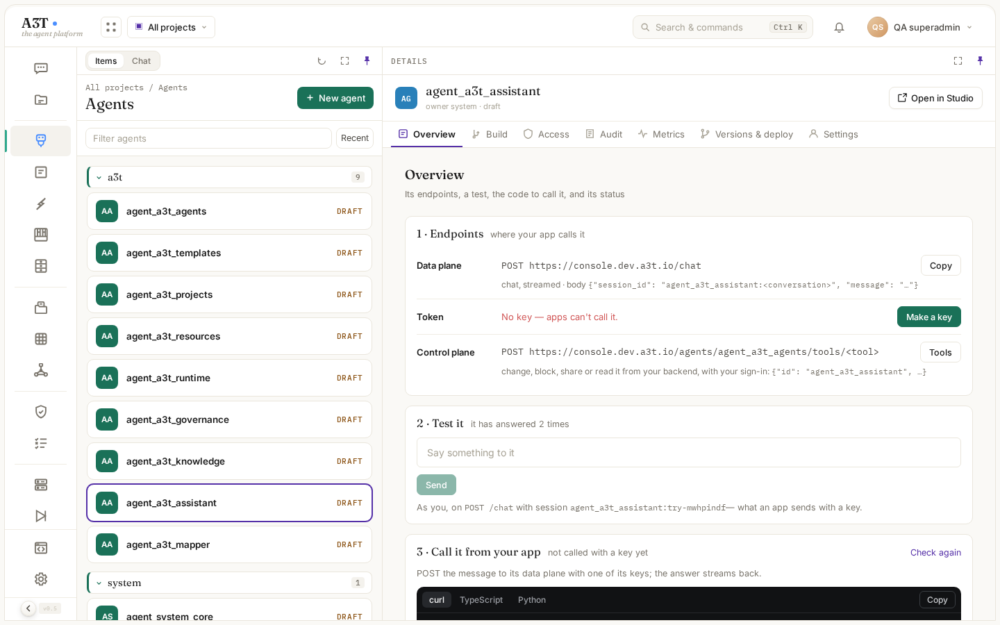

import { Aside } from '@astrojs/starlight/components';

A3T is a platform for **agents that other software calls**. You build an agent in A3T, give it a key, and your app sends it messages over HTTP. A3T runs it, remembers what it learns and checks every step it takes against your policies.

Think of it as the hosting layer for agents: what a payments API is for payments, A3T is for agents. Your product stays where it is; the agent is a service it calls.

## The problem

An agent that works in a notebook is a long way from one you can put in front of customers. The gap is the same in every team:

| What an agent needs in production | What teams usually end up with |
|---|---|
| A stable endpoint and keys for the apps that call it | A script behind an ad hoc web server |
| Memory that lasts across sessions, restarts and redeploys | A prompt that grows every turn, or a vector store bolted on |
| Rules on what it may do, checked on every step | Prompt instructions, and hope |
| A record of what it did and why | Chat transcripts, if anyone kept them |
| Versions, review and rollback | Edits made live in production |
| A place to run, pause and scale | One process per team, each built differently |

A3T provides each of these once, for every agent.

## What you get

- **Agents over an API.** Every agent has a data plane (`POST /chat`, streamed) that apps call with an agent key, and a control plane for changing, blocking or sharing it.
- **Memory that lasts.** Each agent has its own memory space in ADB, A3T's agent database, with five kinds of memory: working, episodic, semantic, procedural and tools. It survives restarts and redeploys, and you can read and edit it in the console.
- **Governance on every step.** A3T checks each tool call, model call and flow start against Cedar policies, as the user the agent acts for. A refusal names the policy that refused it. Every decision is logged.
- **Projects and roles.** Everything belongs to a project, personal or an organisation's. Who can see, change or run it follows the project's members and their roles.
- **Code you can read.** Templates and flows are [YAML](https://blog.a3t.io/how-to-read-and-write-yaml/) in the [CNCF Serverless Workflow](https://blog.a3t.io/cncf-workflow-dsl-explained/) format, versioned and diffable. An agent is a template plus its settings.
- **One place to run.** Deploy an agent onto a runtime, pause it, resume it or undeploy it, from the console or the API.

## An example

A support team wants an agent their help-desk app can call. In A3T they:

1. create an agent from the built-in agent template, with their model and their ticketing tools;
2. make a key for it;
3. call it from the help-desk app.



The agent's Overview shows everything the app needs: the endpoint, the key and a snippet to call it.

```bash
curl -N "$A3T_URL/chat" \
  -H "Authorization: Bearer $AGENT_KEY" \
  -H "Content-Type: application/json" \
  -d '{"session_id": "agt-1a2b3c4d:ticket-4182", "message": "Customer says the refund never arrived. What now?"}'
```

The answer streams back. Behind that one call, A3T:

- checked that the key belongs to this agent;
- loaded the agent's settings and the ticket's past turns from memory;
- called the model;
- checked each tool call against policy;
- logged the decisions;
- saved the turn to memory.

The next message in `ticket-4182` starts where this one left off.

<Aside type="tip">
`$A3T_URL` is your A3T console address. The `session_id` is `<agent id>:<conversation>`. A key only reaches its own agent, so an app can't use one agent's key to talk to another.
</Aside>

## Who uses what

| Who | Where they work | What they do |
|---|---|---|
| Developers | VS Code and Claude over MCP, or the console's Studio | Write templates and flows, build agents, wire triggers |
| Security and governance | The console | Write policies, read the decision log, block an agent, review who has access |
| Apps | The API | Call agents with keys |

The console's chat is a test bench for trying agents. Your users talk to your app, and your app talks to the agent.

## Next

[How it works](../architecture/) shows the parts of A3T and the path of one request through them.
